<div align="center">


# Assetboard

Reminds you before domains, subscriptions and servers expire. Import with a token, then leave the app closed.

[](https://github.com/hippone-labs/assetboard/actions/workflows/build.yml)
[](LICENSE)
[](https://assetboard.app/)
[](https://github.com/hippone-labs/assetboard/releases/latest)

[Website](https://assetboard.app/) · [User guide (Chinese)](GUIDE.md) · [简体中文](README.md) · [Issues](https://github.com/hippone-labs/assetboard/issues/new/choose)

</div>

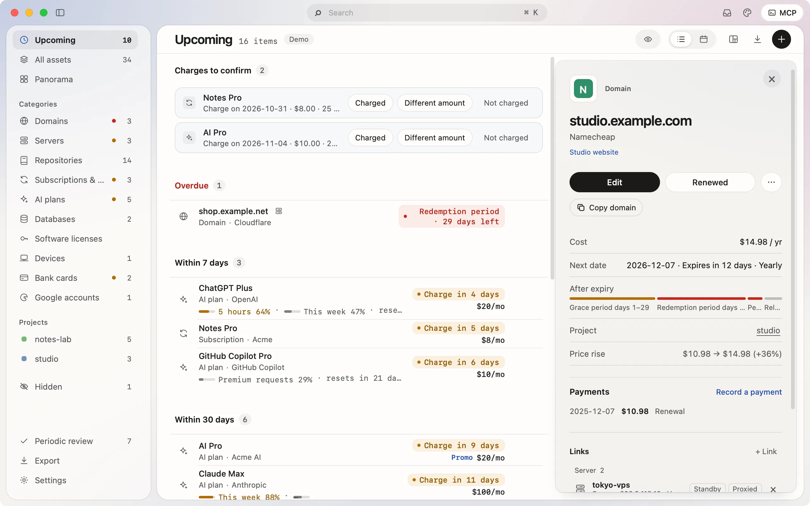

<sub>Screenshots are from demo mode; the data is fictional.</sub>

Download the `.dmg` from [assetboard.app](https://assetboard.app/). Requires macOS 15 or later on Apple Silicon. Data stays on the Mac; there is no account. The interface is in English by default and can be switched to Simplified Chinese in Settings.

## Contents

- [Get started](#get-started)
- [What it reminds you of](#what-it-reminds-you-of)
- [Data and network](#data-and-network)
- [What it records](#what-it-records)
- [Interface](#interface)
- [Themes](#themes)
- [Data sources](#data-sources)
- [Other features](#other-features)
- [Free and Pro](#free-and-pro)
- [Install](#install)
- [Build from source](#build-from-source)
- [Contributing](#contributing)
- [License](#license)

## Get started

1. Download from the site and drag Assetboard into Applications.
2. Import records that come with an expiry date. In the Mac app, paste a domain or a URL; it looks up the expiry date and registrar at the registry and fills the empty fields. Some TLDs have no such lookup (for example cn, io and de), so you fill those dates in yourself. You can also import with a read-only Cloudflare token: expiry dates come only for domains registered at Cloudflare, and only if the token can read Registrar data; a Zone that is just DNS will not have a date. New finds are listed first; they are written only after you tick them.
3. Once a record has a date, the app asks for notification permission. Allow it. You don't have to keep the window open; a notification appears at 9:00 on the morning of each reminder.

GitHub and `~/.ssh/config` can import repositories or servers, but they don't bring expiry dates, so they won't produce reminders. Subscriptions are added by hand, or imported from a table, an email or a screenshot. The browser version has no system notifications and does not query the registry.

## What it reminds you of

Reminders only cover dates already stored on an asset:

- Expiry and charges: 30, 7 and 1 days ahead
- Monthly charges, trial ends and cancel-by dates: 3 and 1 days ahead
- A one-off expiry or a number kept alive: on the day, then again on the 3rd and 14th day after
- An auto-renewal whose expiry has passed: a reminder the next day, and it stays under "renewals to confirm" until you mark it renewed or not

Notifications go out at 9:00 that morning; a date added after 9:00 will not get that day's reminder. Clicking a notification opens Upcoming. The menu bar (optional) shows how many fall in the next 7 days. A record with no date is not scheduled. Certificate expiry, traffic caps and usage quotas do not send notifications yet.

## Data and network

- Data is in `~/Library/Application Support/Assetboard/`: `assetboard.sqlite`, with a JSON mirror `board.json`. No cloud sync or telemetry.
- Tokens and API keys are stored in the macOS Keychain.
- Hosts the app contacts on its own: update checks (assetboard.app), site icons of known providers, exchange rates (api.frankfurter.dev), and Cloudflare once connected. Other connections (RDAP, AI, the AI tools' quota endpoints, live status, GitHub, Namecheap, Porkbun, Hetzner, DigitalOcean, Vercel) happen only after you turn them on or click.
- The page itself is barred from the network by its Content-Security-Policy; every request goes through the Swift side and is recorded in the network log.
- Data given to external AI tools has IPs, hosts, phone numbers and emails masked by default and leaves out bank card and phone records.

The full host list is in the [user guide](GUIDE.md#隐私与网络) (Chinese).

## What it records

13 categories: domain, server, repository, deployment, database, object storage, subscription and tool, AI subscription, software licence, bank card, phone number, Apple ID, Google account.

- A server can hold up to 4 IPs and an SSH host, user and port.
- A bank card holds only the last four digits, network and expiry; the form refuses full card numbers.
- A link's meaning follows from the two categories: a domain points to a server or deployment, a repository deploys to a deployment, a bank card pays for a subscription, an Apple ID or Google account is used to sign in, a phone number receives verification codes.
- An asset can belong to one or more projects, and a project's assets add up to what the whole project costs: per month, by category, over the next 12 months; with a monthly revenue it shows the net, and an asset shared by several projects is split between them.

## Interface

The sidebar holds Upcoming, All assets, Panorama, the categories, projects and Hidden. The middle shows a tile wall (a panel per category, in three densities) and the right the selected asset's details. It can switch to a list, a grid or a 12-month timeline; Upcoming can switch to a month calendar.

| | |
| --- | --- |
| All assets: a tile wall grouped by category, with one record's details at the right 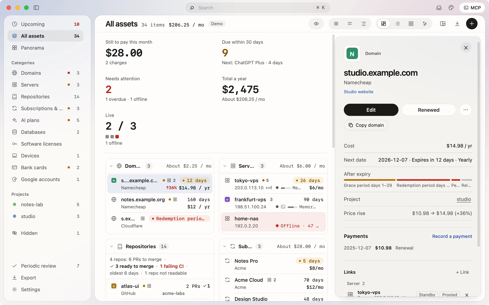 | Cost: monthly and yearly totals by category, in a chosen currency 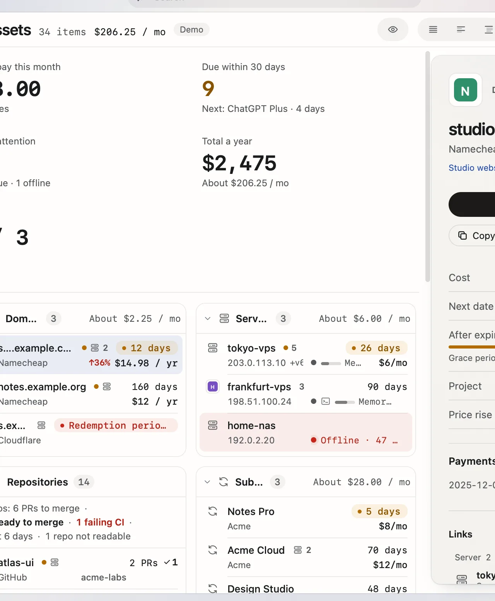 |
| Timeline: expiries and charges over 12 months from this month 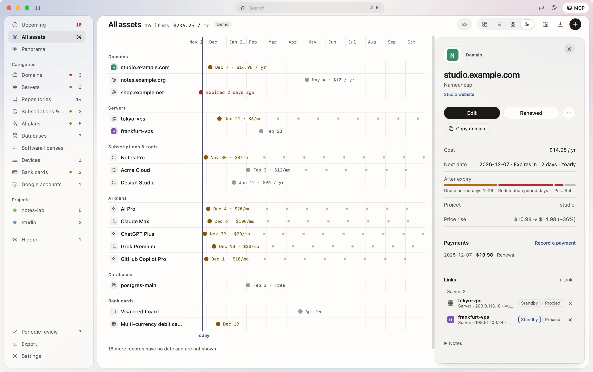 | Panorama: one card per server with the assets on it 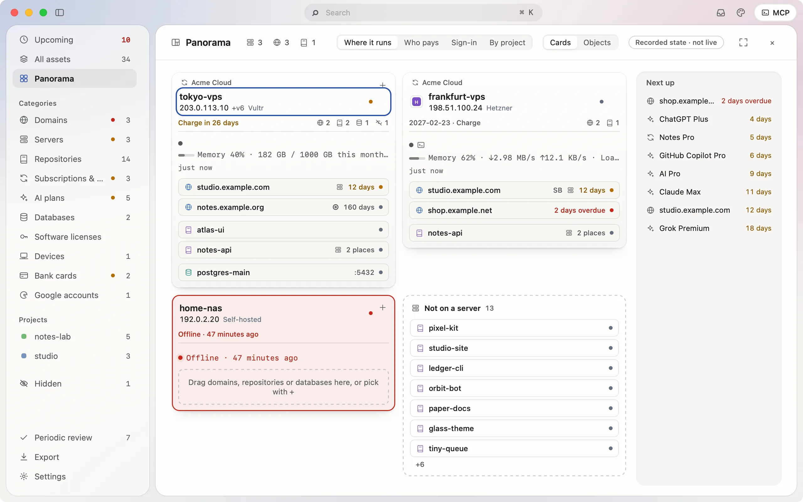 |
| Live status (Pro, off by default): a server's memory, traffic and load 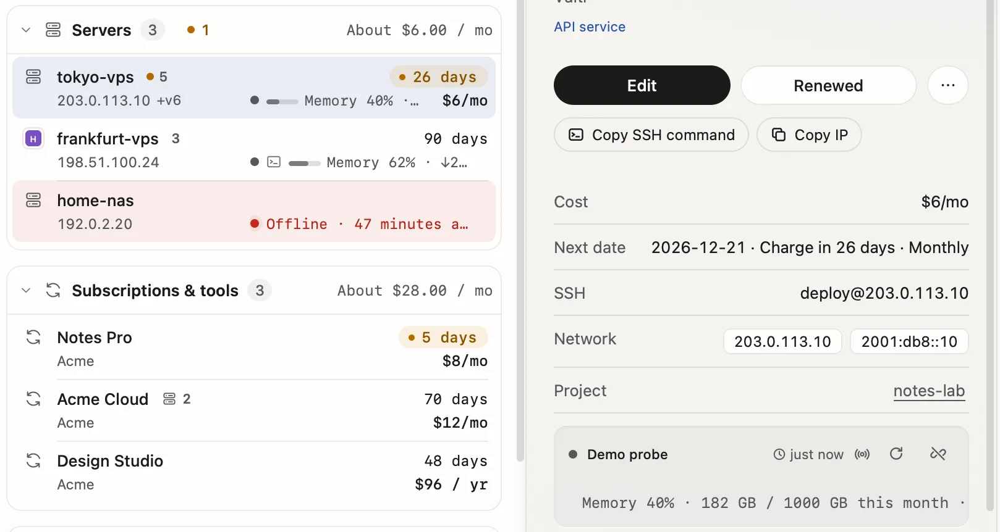 | A free tier's sleep rule and keep-alive settings 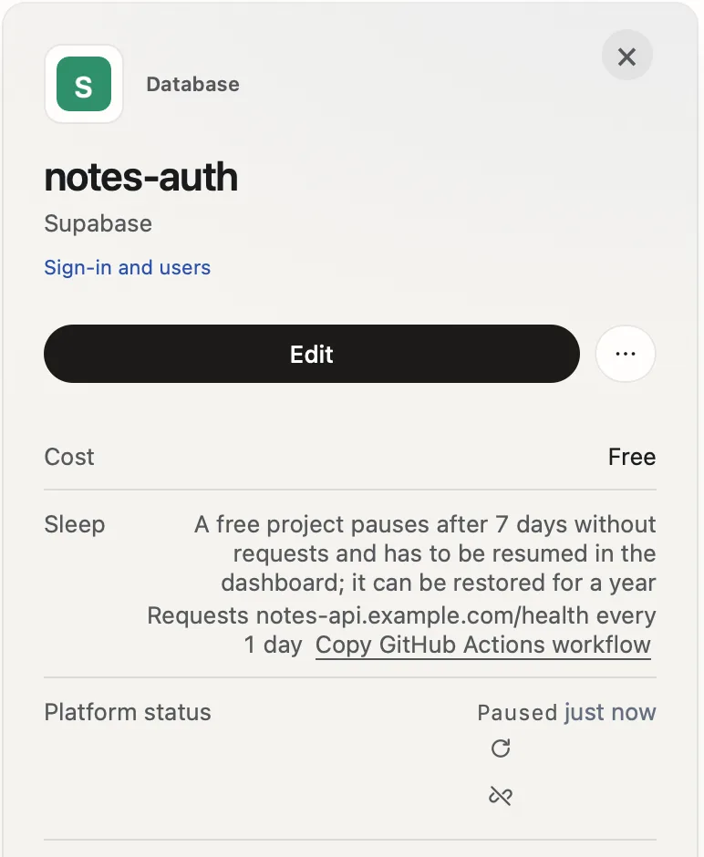 |

The panorama has four lenses: where it runs, who pays, which login, by project. Drag an asset between cards or press `L` to change a link.

## Themes

Two skins: Quiet, and Fridge magnets. Fridge magnets comes with four doors, and the whole window takes the door's colours. Pick one in Settings › Appearance.

| | |
| --- | --- |
| Quiet, light 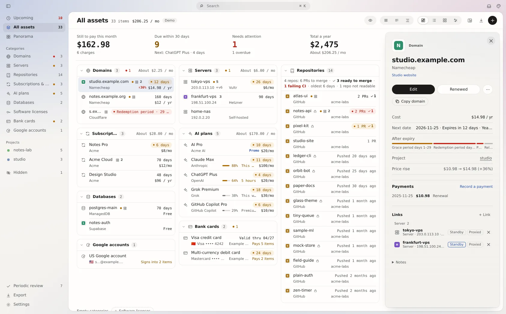 | Quiet, dark 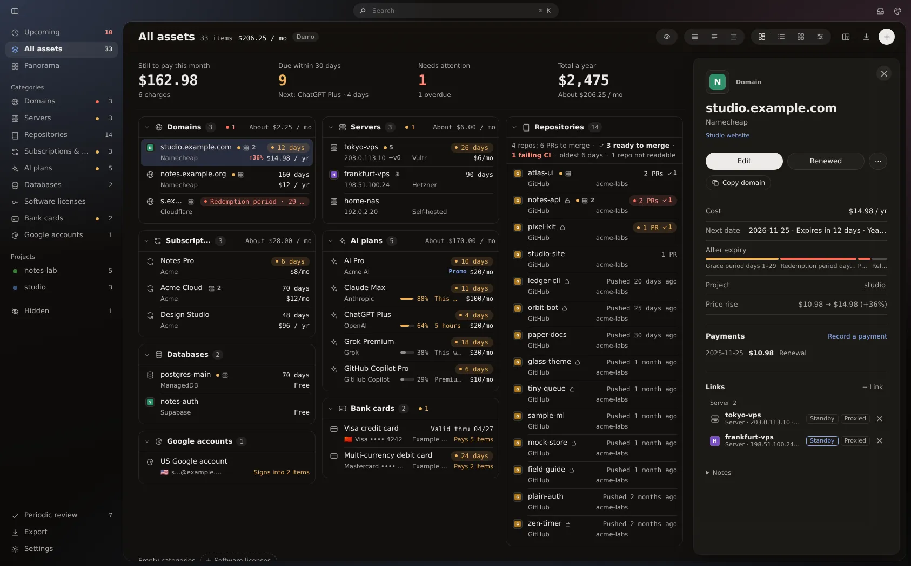 |
| Fridge magnets: Pixel Kitchen 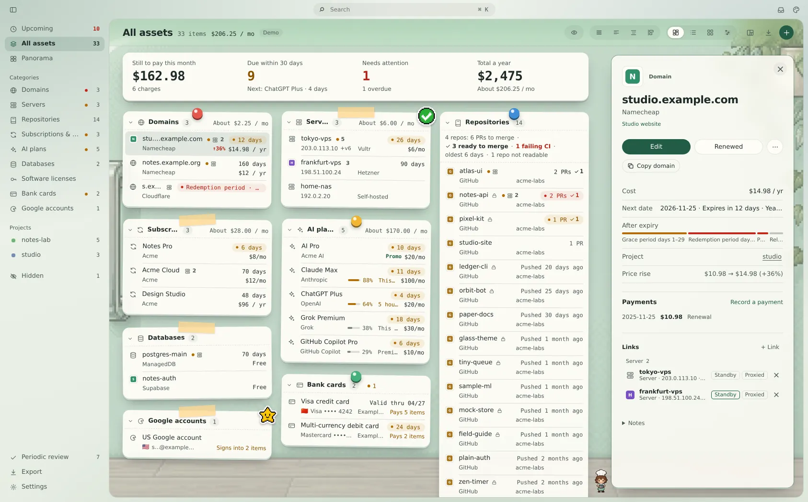 | Fridge magnets: Pixel Night City 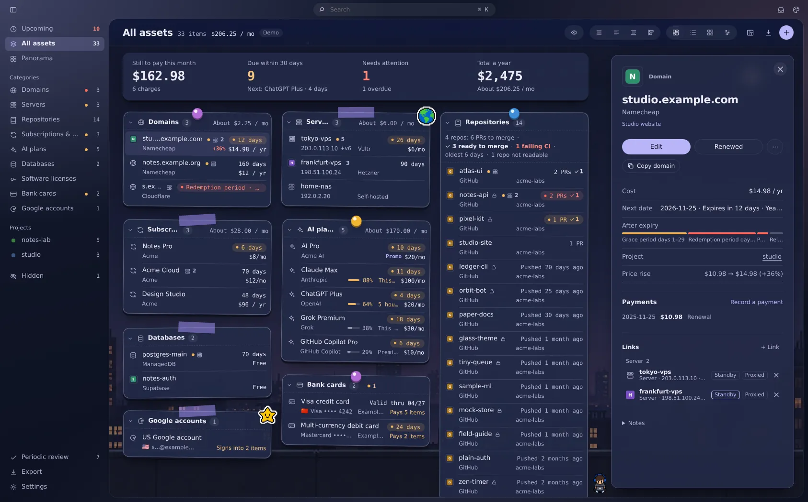 |
| Fridge magnets: Sketchbook Fridge 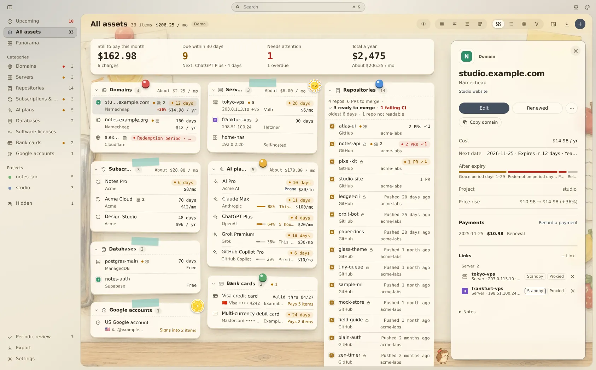 | Fridge magnets: Pixel Server Room 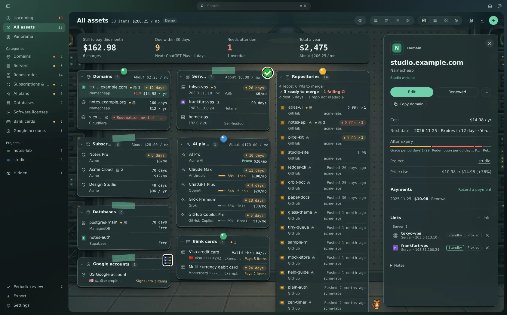 |

## Data sources

| Source | Where |
| --- | --- |
| Manual: pick a category and fill in the form | App, browser |
| Paste a domain or URL: the Mac app fills empty expiry dates and registrars from the registry (RDAP); some TLDs have no RDAP (for example cn, io and de) | App, browser (the browser does not look them up) |
| CSV / TSV / JSON files or a pasted table, previewed before writing | App, browser |
| `.eml` mail and pasted renewal notices, recognised by rules and confirmed one by one | App, browser |
| Screenshots and PDF, recognised on the Mac with macOS text recognition | App |
| Cloudflare (read-only API token): zones, Pages, Workers, R2; expiry dates only for domains registered at Cloudflare when the token can read Registrar data | App |
| GitHub (local `gh` or a read-only token): repositories, with no expiry date | App |
| Namecheap, Porkbun: domains, expiry dates and auto-renew. Not yet verified with a real account | App |
| Hetzner, DigitalOcean, Vercel: servers or projects; domains registered at Vercel can include an expiry date. Not yet verified with a real account | App |
| `~/.ssh/config`: Host, HostName, User, Port; code hosting such as github.com (or `User git`) is not taken as a server. No expiry date | App |
| An AI model you configure (Claude, OpenAI-compatible or Ollama) for screenshots, mail and text | App |

Scripts can put JSON in this format into `~/Library/Application Support/Assetboard/Inbox/` or drop it on the window; each file is confirmed in the import preview. Write it under a temporary name, then rename it to `.json`; at most 100 items and 1 MB; other fields are ignored:

```json
{"assetboard": 1, "items": [
  {"name": "example.com", "type": "domain", "provider": "Namecheap", "account": "me@example.com",
   "date": "2027-03-01", "dateKind": "expire", "cycle": "yearly", "cost": "$10.98 / year",
   "url": "https://ap.www.namecheap.com", "notes": "", "purpose": ""}
]}
```

## Other features

- Renewal records, payment records and price changes.
- RDAP checks of a domain's expiry date and status at the registry.
- Exports: JSON backup (can be imported again), calendar .ics, payment ledger .csv, handover list .html.
- Privacy mode: masks names, accounts and IPs.
- Network log: lists every request the app makes.
- An MCP server and the `assetboard-cli` command line for Claude Code, Codex, Cursor and other tools to read and write assets. Every external call goes into a local MCP activity log (which client, when, which tool, what changed), shown in Settings › MCP.
- AI usage and limits: plan limits and usage of Claude Code, Codex, Cursor, GitHub Copilot, Grok CLI, opencode and Antigravity, read from their local files and shown on the matching AI subscription: close to the limit, idle, worth its price at API rates or not. Only numbers, model names and times are read.
- Repositories (Mac, off by default): a GitHub sync also reads branches and the latest Actions run; a failed or running run leads the row, and new branches show for 14 days.
- Keyboard control; `?` lists the shortcuts.
- Accent themes, two tile-wall skins (Quiet; Fridge magnets, with four fridge doors whose colours the whole window takes, and panels you place anywhere) and three densities; light and dark follow the system.

## Free and Pro

The app and the read-only MCP are free and open source, with no time or record limit. Assetboard Pro is the official plugin that lets AI change, delete and tidy up existing records in bulk through MCP and the command line, plus a few background jobs. Pro is free for now.

| Free and open source | Pro (official plugin, free for now) |
| --- | --- |
| Asset board, Upcoming, local reminders, renewal and charge confirmations | AI changing, deleting and tidying up existing records in bulk through MCP and the command line |
| Payment ledger, 12-month forecast, price changes | Weekly automatic registry check |
| Projects, revenue and shared costs, shutdown list, periodic review | Cloudflare sync every 12 hours, with a note when new assets appear |
| Every import; connecting Cloudflare, GitHub, Namecheap, Porkbun, Hetzner, DigitalOcean and Vercel, then picking and syncing by hand; AI recognition with your own key | Live status (SSH reads, monitoring panels, platform status) |
| Read-only MCP and the `assetboard-cli` command line: look up; also add new records (same names skipped) and import what waits; the Inbox folder | Planned: encrypted snapshots, a handover pack |
| Links, panorama, AI usage, privacy mode, network log, backups and exports | |

Getting Pro: download the official build from [assetboard.app](https://assetboard.app/). Pro is already inside and on, with no sign-up and no license to enter; Settings › Assetboard Pro shows its state. This repository is the whole code of the free part; what you build from it is the complete free edition, without the Pro plugin. See the [user guide](GUIDE.md#assetboard-pro) (Chinese).

## Install

Download the `.dmg` from [assetboard.app](https://assetboard.app/) and drag Assetboard into Applications. Requires macOS 15 or later on Apple Silicon. The package is signed and notarized; the app updates itself.

Each GitHub Release also has [SHA256SUMS.txt](https://github.com/hippone-labs/assetboard/releases/latest/download/SHA256SUMS.txt). Put it next to the package and run `shasum -a 256 -c SHA256SUMS.txt --ignore-missing` to verify.

Start with demo data (your data is not read or written, nothing goes over the network):

```sh
open /Applications/Assetboard.app --args --demo
```

## Build from source

Prerequisites (versions come from `desktop/Info.plist` and `.github/workflows/build.yml`):

| Need | Version | For |
|---|---|---|
| macOS and chip | Apple silicon (arm64) only; the app runs on macOS 15.0 or later (`LSMinimumSystemVersion`). CI builds on macOS 26; before a release the Swift job is also run by hand on macOS 15 | building and running the app |
| Xcode / Swift | Minimum: Xcode command line tools with `swiftc` (`./desktop/build.sh` calls `xcrun swiftc`). Verified: Xcode 26.6 on CI; the full Xcode is needed only to compile the macOS 26 app icon (`Assets.car`), otherwise the committed one is used | `./desktop/build.sh` |
| Node | Verified: 22 in CI (`node --test` needs no packages) | unit tests |
| Python 3 | Any recent 3 (CI uses the runner default); no packages | browser version local server, `tools/` tests |
| Playwright | Verified: 1.64.1 with Chromium; install once with `npm install --no-save playwright && npx playwright install chromium`, then `node tools/browser-tests.js` | UI tests (`tests/*.playwright.js`) |

There is no package.json, bundler or third-party dependency.

```sh
./desktop/build.sh        # builds dist/Assetboard.app (ad-hoc signed) and runs the native self-tests; needs macOS and the Xcode command line tools
node --test               # unit tests
```

The browser version needs no build and keeps data in the browser's localStorage, without notifications, text recognition, AI recognition or Keychain:

```sh
python3 -m http.server 4317 --bind 127.0.0.1    # open http://127.0.0.1:4317; ?demo for demo data, ?lang=zh for Chinese
```

| Path | Contents |
| --- | --- |
| `index.html`, `*.js`, `*.css` | The interface both hosts share; pure functions are in `asset-data.js`, with unit tests |
| `desktop/` | The macOS app (Swift) and the build and packaging scripts |
| `i18n/` | English strings |
| `tests/` | Node unit tests and Playwright UI tests |
| `GUIDE.md` | The user guide (Chinese) |

## Contributing

Bug reports, provider rules (for example, how many days after expiry a cloud provider deletes a server) and suggestions can go through the [issue forms](https://github.com/hippone-labs/assetboard/issues/new/choose); pull requests are welcome, see [CONTRIBUTING.md](CONTRIBUTING.md). Mail: lihaosong1109@gmail.com.

## License

[GPL-3.0](LICENSE).
