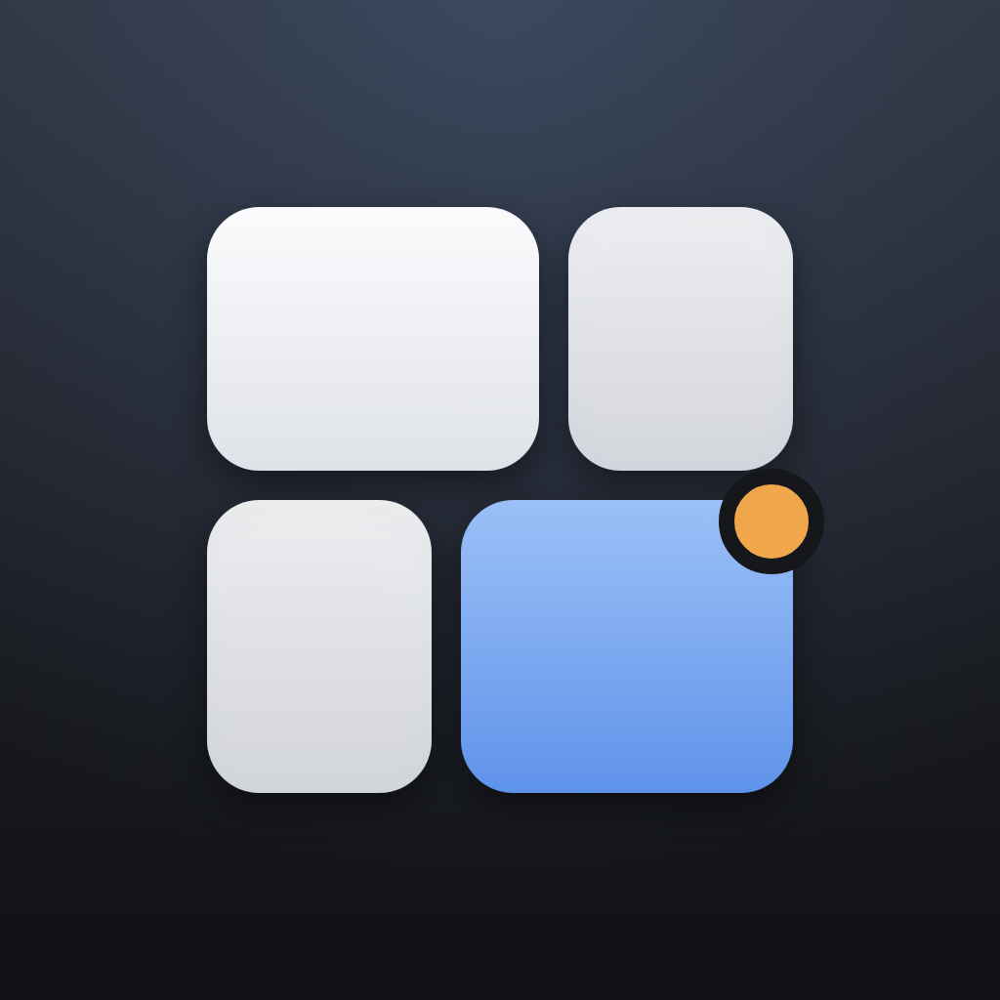
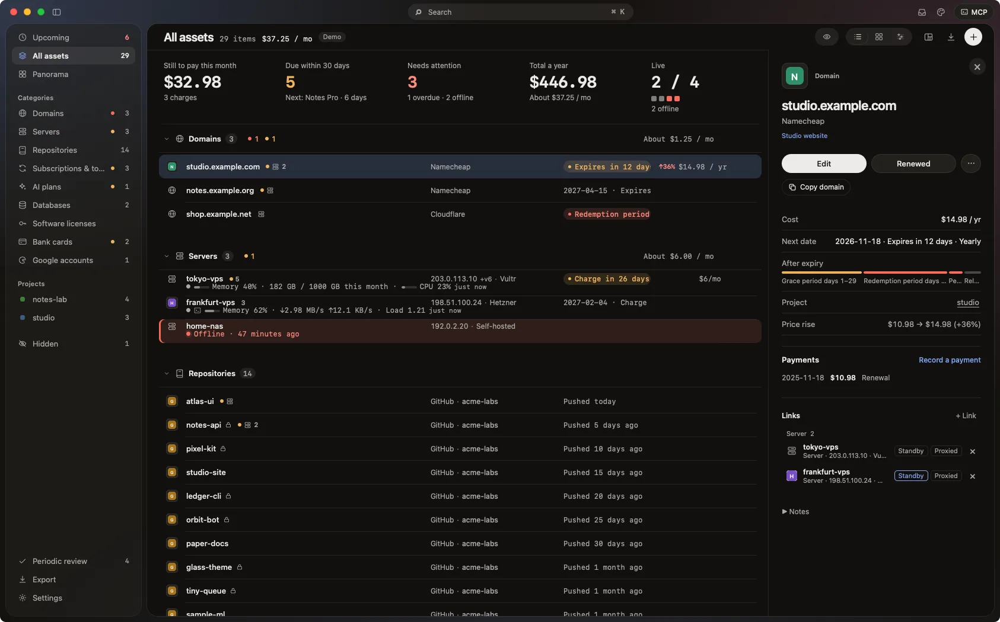
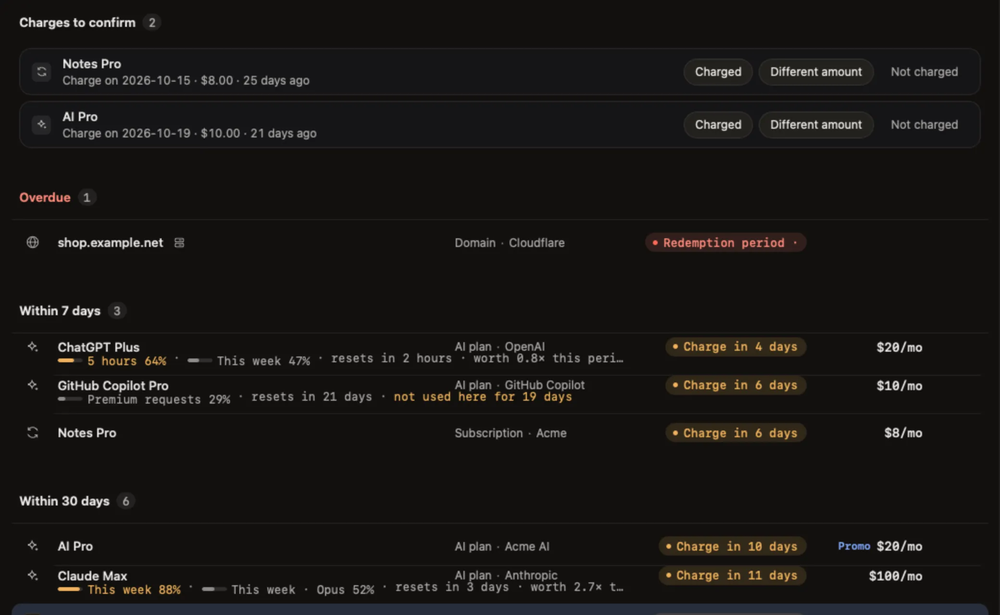
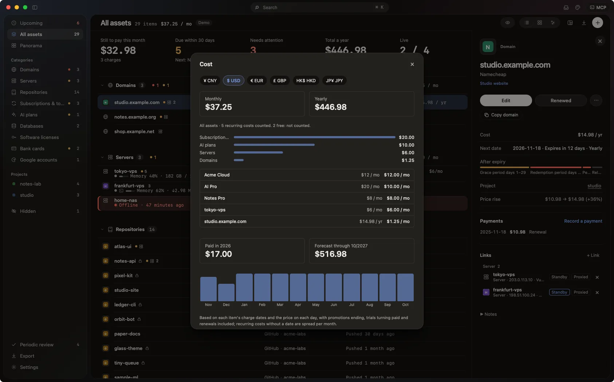
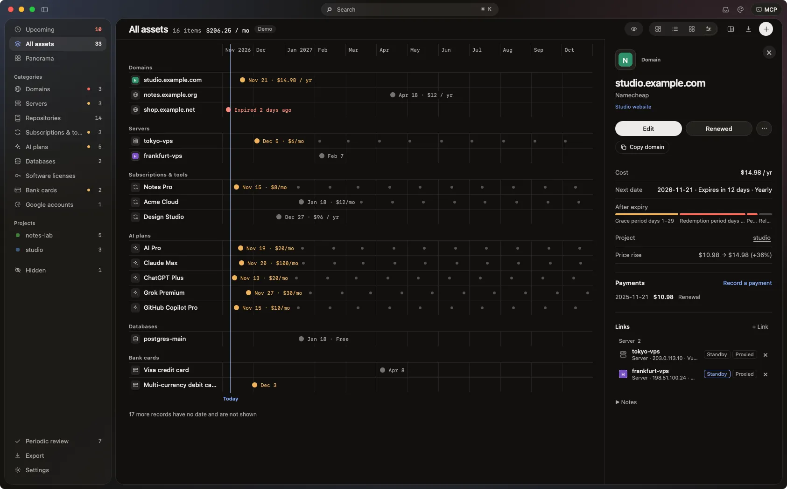
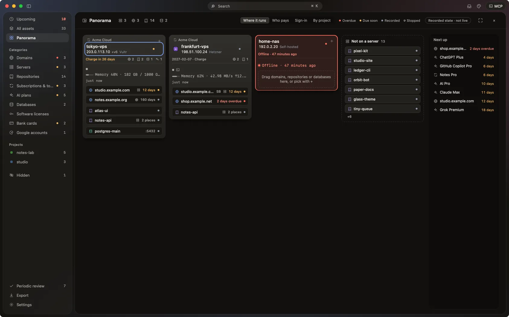
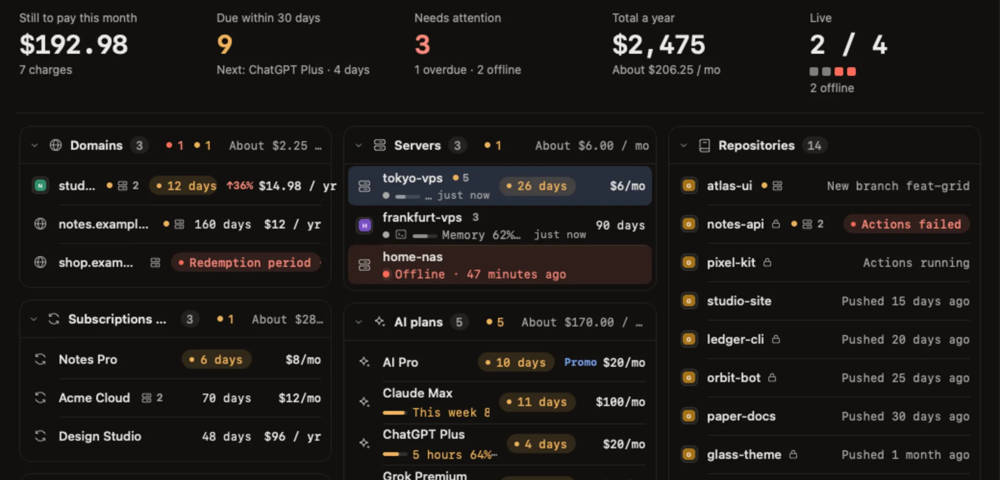
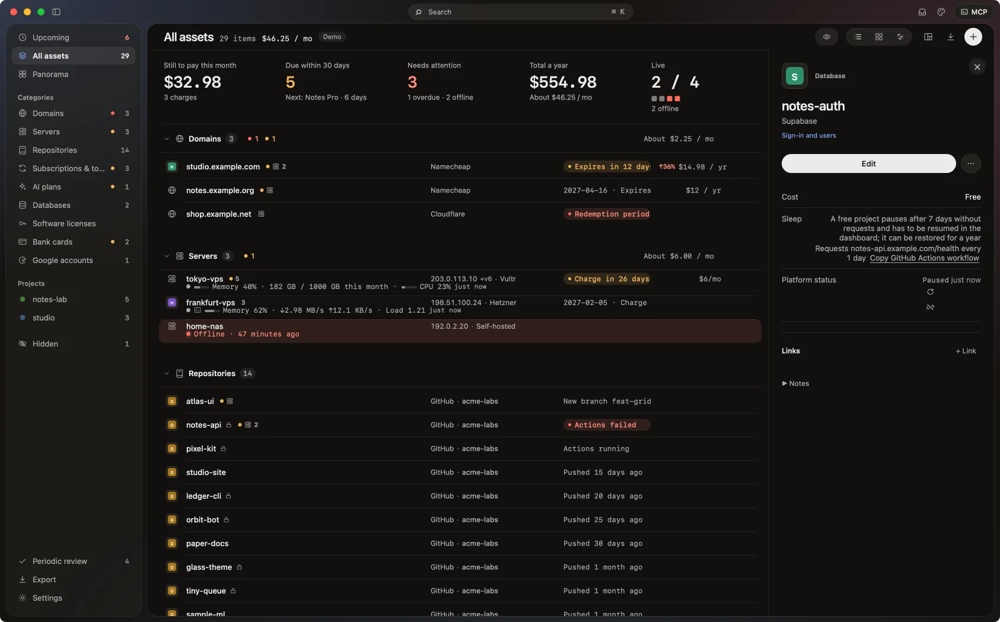

<div align="center">



# Assetboard

A macOS app that records the expiry dates, costs and relations of digital assets such as domains, servers, repositories and subscriptions.

[](https://github.com/hippone-labs/assetboard/actions/workflows/build.yml)
[](LICENSE)
[](https://assetboard.app/en/)
[](https://assetboard.app/en/)

[Website](https://assetboard.app/en/) · [User guide (Chinese)](GUIDE.md) · [简体中文](README.md) · [Issues](https://github.com/hippone-labs/assetboard/issues/new/choose)

</div>



<sub>Screenshots are from demo mode; the data is fictional.</sub>

## Contents

- [Overview](#overview)
- [What it records](#what-it-records)
- [Interface](#interface)
- [Data sources](#data-sources)
- [Other features](#other-features)
- [Free and Pro](#free-and-pro)
- [Data and network](#data-and-network)
- [Install](#install)
- [Build from source](#build-from-source)
- [Contributing](#contributing)
- [License](#license)

## Overview

Assetboard is a local app. Each asset has a date (expiry, auto-renew charge, trial end or cancel-by, optionally repeating monthly or yearly), a cost, a provider, an account and a management link, and assets can be linked to each other. From those dates the app lists what is due and sends system notifications; from the costs it computes totals.

Data is kept in a SQLite file on the Mac; there is no account. The interface is one set of HTML/CSS/JS pages that the Mac app loads in a WKWebView; the same pages also run in a browser with fewer features. The interface is in Simplified Chinese and English.

## What it records

13 categories: domain, server, repository, deployment, database, object storage, subscription and tool, AI subscription, software licence, bank card, phone number, Apple ID, Google account.

- A server can hold up to 4 IPs and an SSH host, user and port.
- A bank card holds only the last four digits, network and expiry; the form refuses full card numbers.
- A link's meaning follows from the two categories: a domain points to a server or deployment, a repository deploys to a deployment, a bank card pays for a subscription, an Apple ID or Google account is used to sign in, a phone number receives verification codes.
- An asset can belong to one or more projects, and a project's assets add up to what the whole project costs: per month, by category, over the next 12 months (Pro).

## Interface

The sidebar holds Upcoming, All assets, Panorama, the categories, projects and Hidden. The middle shows the list and the right the selected asset's details. The list can switch to a grid or a 12-month timeline; Upcoming can switch to a month calendar.

| | |
| --- | --- |
| Upcoming: grouped into overdue, within 7 days, within 30 days and later  | Cost: monthly and yearly totals by category, in a chosen currency  |
| Timeline: expiries and charges over 12 months from this month  | Panorama: one card per server with the assets on it  |
| Live status (Pro, off by default): a server's memory, traffic and load  | A free tier's sleep rule and keep-alive settings  |

The panorama has four lenses: where it runs, who pays, which login, by project. Drag an asset between cards or press `L` to change a link.

## Data sources

| Source | Where |
| --- | --- |
| Manual: pick a category and fill in the form | App, browser |
| CSV / TSV / JSON files or a pasted table, previewed before writing | App, browser |
| `.eml` mail and pasted renewal notices, recognised by rules and confirmed one by one | App, browser |
| Screenshots and PDF, recognised on the Mac with macOS text recognition | App |
| Cloudflare (read-only API token): zones, Pages, Workers, R2 | App |
| GitHub (local `gh` or a read-only token): repositories | App |
| `~/.ssh/config`: Host, HostName, User, Port; code hosting such as github.com (or `User git`) is not taken as a server | App |
| An AI model you configure (Claude, OpenAI-compatible or Ollama) for screenshots, mail and text | App |

Scripts can put JSON in this format into `~/Library/Application Support/Assetboard/Inbox/` (Pro) or drop it on the window; each file is confirmed in the import preview. Write it under a temporary name, then rename it to `.json`; at most 100 items and 1 MB; other fields are ignored:

```json
{"assetboard": 1, "items": [
  {"name": "example.com", "type": "domain", "provider": "Namecheap", "account": "me@example.com",
   "date": "2027-03-01", "dateKind": "expire", "cycle": "yearly", "cost": "$10.98 / year",
   "url": "https://ap.www.namecheap.com", "notes": "", "purpose": ""}
]}
```

## Other features

- System notifications: 30, 7 and 1 days before an expiry; 3 and 1 days before a monthly charge, trial end or cancel-by date.
- An auto-renewal on its charge day waits in Upcoming until you confirm whether it was charged.
- Renewal records, payment records and price changes.
- RDAP checks of a domain's expiry date and status at the registry; pasting a domain, a web address or a list of domains makes the records and fills their expiry dates and registrars from the registry.
- Exports: JSON backup (can be imported again), calendar .ics, payment ledger .csv, handover list .html.
- Privacy mode: masks names, accounts and IPs.
- Network log: lists every request the app makes.
- An MCP server and the `assetboard-cli` command line for Claude Code, Codex, Cursor and other tools to read and write assets.
- Keyboard control; `?` lists the shortcuts.
- Accent themes; light and dark follow the system.

## Free and Pro

The free edition has no time or record limit. Pro is a US$10 one-time licence, verified offline on the Mac.

| Free | Pro |
| --- | --- |
| Asset board, Upcoming, local reminders | Payment ledger, 12-month forecast, price changes |
| Links, risk chains, panorama | Weekly automatic registry check |
| Renewal confirmations, hold alerts, manual registry check | Cloudflare sync every 12 hours |
| Every local import (CSV, backup, .eml, screenshots, ssh config), manual Cloudflare and GitHub sync, AI plan picker | Project totals, shutdown list, periodic review |
| AI recognition with your own key | Live status (SSH read, monitoring panels) |
| Cost totals, currencies, JSON backup, .ics export, basic handover list | MCP write tools (add, edit, delete), `assetboard-cli`, Inbox folder |
| Privacy mode, network log, read-only MCP tools | Planned: Reminders, encrypted snapshots, a handover pack |

This repository is the whole code of the free edition; building it gives the free edition. The Pro modules are not in this repository, only in the official build.

## Data and network

- Data is in `~/Library/Application Support/Assetboard/`: `assetboard.sqlite`, with a JSON mirror `board.json`. No cloud sync or telemetry.
- Tokens and API keys are stored in the macOS Keychain.
- Hosts the app contacts on its own: update checks (assetboard.app), site icons of known providers, exchange rates (api.frankfurter.dev), and Cloudflare once connected. Other connections (RDAP, AI, live status, GitHub) happen only after you turn them on or click.
- The page itself is barred from the network by its Content-Security-Policy; every request goes through the Swift side and is recorded in the network log.
- Data given to external AI tools has IPs, hosts, phone numbers and emails masked by default and leaves out bank card and phone records.

The full host list is in the [user guide](GUIDE.md#隐私与网络) (Chinese).

## Install

Download the `.dmg` from [assetboard.app](https://assetboard.app/en/) and drag Assetboard into Applications. Requires macOS 15 or later on Apple Silicon. The package is signed and notarized; the app updates itself.

Start with demo data (your data is not read or written, nothing goes over the network):

```sh
open /Applications/Assetboard.app --args --demo
```

## Build from source

There is no package.json, bundler or third-party dependency.

```sh
./desktop/build.sh        # builds dist/Assetboard.app (ad-hoc signed) and runs the native self-tests; needs macOS and the Xcode command line tools
node --test               # unit tests
```

The browser version needs no build and keeps data in the browser's localStorage, without notifications, text recognition, AI recognition or Keychain:

```sh
python3 -m http.server 4317 --bind 127.0.0.1    # open http://127.0.0.1:4317; ?demo for demo data, ?lang=en for English
```

| Path | Contents |
| --- | --- |
| `index.html`, `*.js`, `*.css` | The interface both hosts share; pure functions are in `asset-data.js`, with unit tests |
| `desktop/` | The macOS app (Swift) and the build and packaging scripts |
| `i18n/` | English strings |
| `tests/` | Node unit tests and Playwright UI tests |
| `GUIDE.md` | The user guide (Chinese) |

## Contributing

Bug reports, provider rules (for example, how many days after expiry a cloud provider deletes a server) and suggestions can go through the [issue forms](https://github.com/hippone-labs/assetboard/issues/new/choose); pull requests are welcome, see [CONTRIBUTING.md](CONTRIBUTING.md). Mail: assetboard@163.com.

## License

[GPL-3.0](LICENSE).
