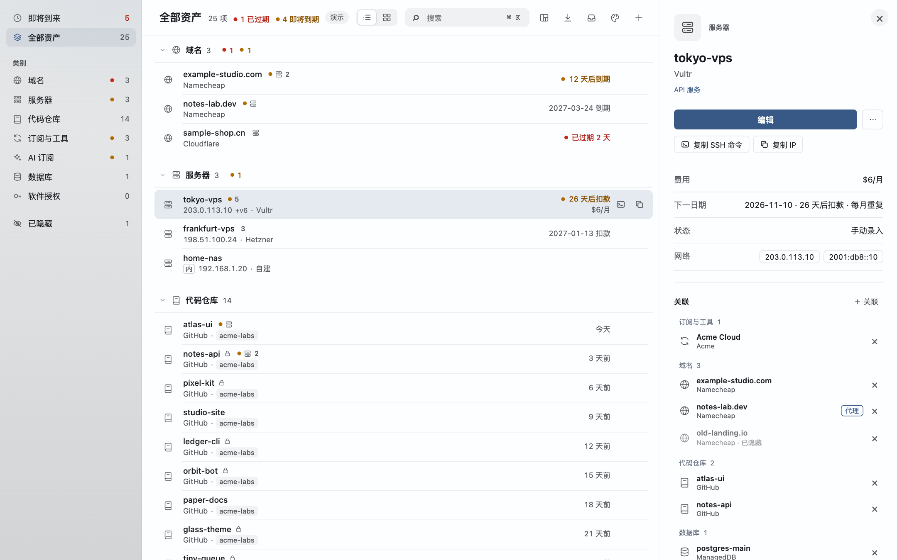

# Assetboard

*A local-first dashboard for your domains, VPS, repos and subscriptions. Native macOS app, nothing leaves your machine.*

面向个人开发者和小团队的本地数字资产总览：域名、VPS、代码仓库、订阅，按类别列在一页里，什么时候到期、哪天扣款，一眼看到。免费，以 GPL-3.0 开源。官网：[assetboard.app](https://assetboard.app)




## 亮点

- **数据只留本机。** 资产存在本地 SQLite，另有可读的 JSON 备份；没有账号、没有服务端、没有同步。
- **一页看全。** 侧边栏切换“即将到来”、“全部资产”和各类别；全部资产按类别分组、列表或网格显示，每行直接写下次到期 / 扣款日期和费用，快到期标黄、过期标红。点一行在右侧看详情。
- **到期前提醒，过期后也不撒手。** 到期、扣款、试用结束和取消截止前，用 macOS 系统通知提醒你：一般提前 30、7、1 天，按月扣款、试用和取消截止提前 3、1 天，都在早上 9 点。一次性到期和保号期限在当天、过期第 3 天和第 14 天再提醒一次，因为过期后的那几天往往还能补救；标为停用的不再追。App 没开着也会弹，点通知直接打开那一项。
- **自动续费也要确认。** 开了自动续费的到期日过了，不会悄悄滚到明年：第二天提醒你，并在“即将到来”的“待确认续费”里等你点“已续上”或“没续上”。点“没续上”就按已过期处理。卡被停、通知发到旧邮箱，都会让自动续费静默失败。
- **续费和付款记在一起。** 按 `R` 标记已续费：日期顺延、实付金额记下、价格变了顺手更新；自动扣款到日子会在“即将到来”里等你点一下“已扣款”。涨价、优惠到期一眼可见，付款账本可导出。
- **按项目看钱。** 给资产标上项目，侧边栏按项目列出、单独合计；不想做了，一键生成按截止日期排好的关停清单。
- **定期清理。** 按“每月多少钱 × 多久没动过”排队，一项一项决定保留、停用还是隐藏。
- **关联与全景。** 域名、仓库、数据库可以挂在服务器、部署服务或对象存储上，订阅可以记上付款卡；按 `P` 进入全景，在“运行在哪”“谁在付钱”“用什么登录”“按项目”几个视角之间切换，一屏看清每台服务器、每个部署、每张卡、每个账号、每个项目里有什么；拖动或点卡片上的 ＋ 就能改关联。
- **多种导入。** 粘贴或拖入 CSV / JSON / 邮件，识别截图和 PDF，接 GitHub、Cloudflare，读 `~/.ssh/config`。导入先预览，确认才写入，整批可撤销。
- **键盘友好。** 搜索、导入、关联、全景、隐藏、置前都有单键快捷键，`?` 查看全部。

## 下载与安装

到 [assetboard.app](https://assetboard.app/) 下载最新的 `Assetboard-macOS-arm64-*.zip`，解压后打开 `Assetboard.app`。安装包只在官网发布；App 的「检查更新」每天最多读一次官网的版本文件（`/downloads/latest.json`），下载后核对校验值、签名和公证再替换。

- 系统：macOS 12 或更高，仅提供 Apple Silicon（arm64）版本。
- 安装包已签名并公证，双击即可打开。
- 也可以不装，直接在浏览器里试：见下文“从源码构建”。

想先看看效果，用演示数据启动（不读也不写你的数据）：

```sh
open Assetboard.app --args --demo   # 在解压后的目录里执行
```

浏览器版在地址后面加 `?demo`。

## 快速上手

1. **放进资产。** 按 `I` 打开导入，拖入或粘贴文件；或者按 `N`：粘贴文字、拖入文件，或直接打一行（如 `example.com namecheap 2027-03-01 $11/年`），类别、日期、金额自动识别，配置了 AI 时由模型识别；日期和金额也可以点按钮、直接输入，不用下拉。每项可以记下次日期（到期 / 自动续费扣款 / 试用结束 / 取消截止，可按月或按年重复）、费用、账号、备注、管理链接。服务器可填最多 4 个 IP，列表和详情里都能一键复制。第一次生成待发送的提醒时，App 会请求通知权限，允许后才会收到提醒。
2. **挂关联。** 选中一个域名、仓库或订阅，按 `L` 选它挂在哪台服务器上。
3. **看全景。** 按 `P`。“运行在哪”里，每台服务器、每个部署服务、每个对象存储各是一张卡片，列出挂在上面的域名、仓库和数据库，卡片多高由内容决定；“谁在付钱”里，每张银行卡一张卡片，列出它支付的订阅和服务，按月或按年扣费却没记付款卡的单独列出。“用什么登录”里，每个 Apple ID、Google 账号一张卡片，列出用它登录的服务；“按项目”里，每个项目一张卡片，把东西拖到另一个项目就是改归属。顶栏切换视角（只显示有卡片的视角），下次打开会记住。没挂上的放在“未挂载”卡片里，拖到别的卡片上就建立关联（按住 ⌥ 是同时挂两处，拖回“未挂载”是解除）。想一次挂好几样，点卡片右上角的 ＋（或在卡片上按 `+`），勾选要挂上的、取消要取下的，完成后一次 ⌘Z 就能全部撤销。顶栏的各类数量也是开关，点一下就把这一类从全景里收起来，再点一下放回，每个视角分别记住。点卡片标题进入聚焦，点“← 全景”或按 Esc 返回。

## 导入方式

| 来源 | 说明 | 平台 |
|---|---|---|
| CSV / TSV / JSON | 拖入、粘贴或选文件；先预览再写入，一次最多 100 行，同名跳过，疑似密钥的列会丢弃 | App、浏览器 |
| 邮件（.eml） | 拖入后识别账单和续费信息，核对后新建或补充到已有资产 | App、浏览器 |
| 粘贴续费通知 | 本地规则识别商户、金额、周期和日期，核对后新建或补充到已有资产 | App、浏览器 |
| 截图 / PDF | 用 macOS 自带的文字识别在本机识别，进“待确认” | App |
| GitHub | 用本机已登录的 `gh`，或填只读的细粒度令牌（Metadata: Read），同步仓库名称、归属、可见性和归档状态 | App |
| Cloudflare | 只读 API 令牌，读取授权范围内的 Zone、Pages、Workers 和 R2 列表；权限不够的类别跳过 | App |
| `~/.ssh/config` | 只读 Host、HostName、User、Port，生成服务器 | App |
| 服务菜单、Dock | 在任何软件里选中文字，右键 → 服务 →「添加到 Assetboard」，文字会填进添加面板，点「识别」才处理。把邮件、截图、PDF、CSV、JSON 拖到 Dock 图标上，或用“打开方式”选 Assetboard：表格和 JSON 一律先进导入预览，截图和 PDF 在本机识别后进待确认。正在编辑或核对时不会打断，收到的内容在「待确认」里排队，可打开或丢弃。首次安装后若菜单里没有，注销再登录一次 | App |
| MCP 接入 / 命令行 | App 内置 `assetboard-cli`：Claude Code、Claude Desktop 等 MCP 客户端或脚本可以查询、添加、修改资产，新增和修改立即生效（`⌘Z` 撤销），删除要你在 App 里确认。只走本机通道，不经网络。窗口工具栏的「Agent」按钮里有可复制的配置。见下 | App |
| Inbox 文件夹 | 把 JSON 文件放进 `~/Library/Application Support/Assetboard/Inbox/`，App 打开或回到前台时读取，一律先进导入预览，确认才写入；导入或丢弃后原文件才移到 `Inbox/handled/`（保留 30 天），取消预览或退出 App 时文件留在原处。这个格式拖进窗口或 Dock 也能识别。格式见下 | App |
| AI 识别（可选） | 接入你自己的模型（Claude、OpenAI 兼容接口或本机 Ollama），配置后，导入的截图、PDF、邮件和粘贴的文字会自动发给它识别（AI 识别设置里可关掉，关掉后只在你点“用 AI 识别”时发送）。本地规则只认中文账单和通知，英文的靠 AI。尚未用真实 API key 验证 | App |

Agent / 脚本的 JSON 格式（先写成临时名，写完再改名为 `.json`；一份最多 100 项、1 MB，只认下列字段，其余忽略）：

```json
{"assetboard": 1, "items": [
  {"name": "example.com", "type": "domain", "provider": "Namecheap", "account": "me@example.com",
   "date": "2027-03-01", "dateKind": "expire", "cycle": "yearly", "cost": "$10.98 / 年",
   "url": "https://ap.www.namecheap.com", "notes": "", "purpose": ""}
]}
```

导入结果都先预览，无冲突才直接写入，`⌘Z` 整批撤销。删掉的同步项再次导入会跳过。

### 费用

每项资产保留自己的金额和币种（保存时除了显示的文字，还会存 `amount` 和 `currency`）。标题栏的「¥… / 月」是当前视图（全部、某个类别或搜索结果）的周期费用合计；点开可切换计价币种（人民币、美元、欧元、英镑、港币、日元，按浏览者记住），看每月、每年、按类别和最贵的几项。已隐藏、已停用、免费、一次性（另列总额）、没填周期、金额无法识别的不计入每月合计，并写明数量；在优惠期内的按优惠价算。汇率来自欧洲央行参考汇率（Frankfurter，免账号），只在需要换算时由 Mac App 每天最多取一次，记在网络记录里；取不到时用上次的汇率或内置参考汇率，并标明。换算只用于合计，不改动任何资产。

另外：

- **计费方式。** 每项可以是周期付费、一次性、免费或未知。金额填 0 或“免费”就是免费；一次性费用不计入每月合计，单独列出总额；只有金额没有周期的算“没填周期”，不会被当成一次性。
- **优惠价。** 在资料的“更多”里填优惠价、截止日期和之后的价格：优惠期内按优惠价统计，过了截止日自动换成恢复价，这次改价也记进价格历史。列表里带“惠”字的就是在优惠中。
- **价格历史。** 每次费用变化（手动、外部工具、续费、优惠结束）都会记下旧金额、新金额、币种、时间和来源。
- **预计支出。** 费用面板里有到明年同月底的每月预计：按每项的扣款日和当天价格算，优惠结束、试用转付费、到期续费都算进去。

### 续费与付款

- **已续费（`R`）。** 选续 1 个月 / 1 年 / 2 年…或直接填新日期，金额会按时长带出（2 年就是两倍年费），可改。实付金额和当前价格不同时，可以顺手把费用改成新价格。续费从当前到期日往后算，不从付款当天算。整步 `⌘Z` 可撤销。
- **待确认扣款。** 自动扣款（日期类型“自动续费扣款”且有周期）到日子后，在“即将到来”最上面出现：点“已扣款”按原价记下，“金额不同”填实付，“没扣”记下这次没有扣款。只问最近 45 天的；更新到这一版之前的不会补问。
- **付款记录。** 详情里的“付款”列出最近几笔和今年合计，可以“记一笔”或删掉记错的。价格比上一次付款贵了，列表里会标 ↑ 和涨幅。

### 项目

资料里填“项目”，侧边栏就多出“项目”一组。点进去是这个项目的所有资产和每月合计；“关停清单”按截止日期列出每一项该做什么（取消订阅、关掉自动续费、备份后删除实例、归档仓库），提示哪些还关联着项目外的东西，勾上完成的会被标为停用或隐藏。卡、手机号和账号不随项目关停。

### 定期清理

侧边栏底部“定期清理”：没有停用、没有隐藏、有费用或日期的资产，按“每月花费 × 多久没动过”排队，一次一项：`K` 还在用、`S` 停用、`H` 不要了（隐藏）、`→` 下次再说。标了“还在用”的 80 天内不会再出现。

### 导出

侧边栏底部“导出”：

- **资产备份（.json）：** 全部资料、关联和付款记录。只有它能导回来：用“从备份恢复…”或拖进窗口，可以合并，也可以整体替换，`⌘Z` 可撤销。下面三种是只读副本，导入时会提示改用备份。
- **日历（.ics）：** 每个到期和扣款日，按周期重复，提前提醒的天数和 App 一样（早上 9 点）。导入日历软件后，日期改了要重新导出。
- **付款账本（.csv）：** 按年份或全部，每一笔续费和确认过的扣款，附一列按当前计价币种的折算。用 Excel / Numbers 直接打开。
- **交接清单（.html）：** 一页能离开 App 独立阅读的清单：有什么、在哪个账号、多少钱、什么时候到期、谁付款、管理链接。可以选择遮住名称、账号和 IP。不含任何密码。

### 核对域名到期日

域名的“⋯”菜单里有“核对注册局日期”：通过 RDAP（WHOIS 的 JSON 版）查询注册局记录的到期日和状态，和这里记的不一样时可以一键改过来。域名过了到期日时，注册局通常会先自动延一年，这不代表续费成功，所以处在自动续费宽限期、赎回期或待删除时会直接说明当前阶段，不改日期。只在你点的时候查，只访问 IANA 的注册局列表（data.iana.org，每天最多一次）和该后缀的注册局，不经过第三方转发，不访问你的域名本身，请求记在网络记录里。

### 菜单栏

Mac App 在菜单栏有一个小日历图标：显示 7 天内到期和待确认扣款的数量，点开是 30 天内的日期、本月费用合计和“添加资产…”。不想要可以在“设置”里关掉。

### 关联

关联的含义由两边的类别决定，各自有自己的说法：银行卡「支付」订阅、AI、域名、服务器等，对方显示「付款卡」；Apple ID / Google 账号「用于登录」，对方显示「登录账号」；手机号「接收验证码」，对方显示「验证手机号」；代码仓库「部署到」部署服务，域名「指向」部署或存储，部署「使用」数据库和存储；服务器的「所在服务器 / 所属账号」照旧，其余为「相关」。详情和关联选择器都按含义分组。付款卡快到期或已过期时，它支付的项目（服务器经所属账号也算）会提示自动续费可能失败；手机号保号到期时，靠它验证的账号会提示。即将到来里，卡和手机号会写明影响几项；删除或隐藏时会说明涉及的关联。

### 设置

菜单“Assetboard → 设置…”（`⌘,`）或侧边栏底部“设置”，一处管所有开关。左边是分区，右边是选中分区的设置：

- **通用：** 语言（简体中文或 English，默认跟随系统；切换后当场生效，菜单也一起换）、计价币种、隐私模式、在菜单栏显示、系统通知状态。
- **功能：** 全景、探针与 SSH 直读（默认关闭）、外部工具接入（MCP，关掉后一律拒绝调用）、自动获取网站图标、每周核对域名到期日。功能开关按此设备记住，不进资产数据，不随备份走。
- **连接：** Cloudflare、GitHub、AI 识别、MCP 接入、探针数据源，各自显示是否已连接，点“设置…”打开对应面板。
- **关于：** 当前版本、检查更新、自动检查更新。

### 收起侧边栏

标题左边的侧边栏按钮、⌃⌘S 或菜单「显示 → 显示 / 隐藏侧边栏」可以收起左侧面板，列表和全景占满宽度；按此设备记住。

### 隐私模式

顶栏的小眼睛一键隐藏名称、账号和 IP（只保留首字和域名后缀，例如 `s••••••.dev`、`203.0.•••.•••`），列表、详情、悬停提示和全景都会遮住，适合共享屏幕或截图。只改显示，不改资料；搜索、复制和编辑仍用真实值。开关按此设备记住。

### 网站图标

新添加的资产（手动、识别、Agent、同步）如果能认出是已知平台（Cloudflare、GitHub、ChatGPT、Wise 等内置名单），会自动从该平台官网取图标；同平台已有图标就直接复用，不再联网。自动获取只访问内置名单里的官网，失败的站点本次运行不再重试，每次请求都在「网络记录」里。侧边栏底部「获取网站图标」可以批量补齐已有资产（先列出要访问的网站，确认后才开始）；自动获取在「设置」里关掉。订阅、AI 等服务类资产填了管理链接的，批量和详情里的「获取图标」也会用这个链接的域名；域名、服务器、仓库这类自有资产不会去访问你自己的网站。

### 网络记录

Assetboard 没有自己的服务器，也不收集任何数据。侧边栏底部（或菜单「文件 → 网络记录…」）列出 App 发出的每个请求和外部对 App 的调用：检查更新（assetboard.app）、Cloudflare、GitHub、AI 识别、网站图标、注册局 RDAP、本机 `gh` 命令，以及 Agent 通过 `assetboard-cli` 的调用。每条只记方法、主机、路径、状态、大小、耗时、对方 IP 和 TLS 版本，不记请求内容、令牌和查询参数；最多保留 5000 条，可一键清空。页面本身由 Content-Security-Policy 禁止发出任何网络请求，所以联网只可能经过上面这些记录在案的路径。打开资产的管理链接由你的浏览器完成，不经过 Assetboard。

### MCP 接入（外部 AI 工具与命令行）

`Assetboard.app/Contents/MacOS/assetboard-cli` 通过数据目录里的本地 socket（`agent.sock`，仅本用户可读写）调用正在运行的 App；App 没开时会在后台打开它。演示模式不接受调用。

```sh
# Claude Code
claude mcp add assetboard -- /Applications/Assetboard.app/Contents/MacOS/assetboard-cli mcp
# ChatGPT 桌面版的 Codex / Codex CLI（普通对话和网页版不能连本机工具）
codex mcp add assetboard -- /Applications/Assetboard.app/Contents/MacOS/assetboard-cli mcp
# Claude Desktop（claude_desktop_config.json）、Cursor（~/.cursor/mcp.json）及多数 MCP 工具：
# {"mcpServers":{"assetboard":{"command":"/Applications/Assetboard.app/Contents/MacOS/assetboard-cli","args":["mcp"]}}}

assetboard-cli types                                   # 类别
assetboard-cli list [--type domain] [--query 关键词] [--hidden] [--limit 100] [--offset 0]
assetboard-cli get <id>
assetboard-cli add '{"name":"example.com","type":"domain","date":"2027-03-01","dateKind":"expire"}'   # 也可以是数组或 Inbox 格式，- 读标准输入
assetboard-cli update <id> '{"notes":"已续费","date":"2028-03-01"}'
assetboard-cli delete <id> --reason "已转出"            # 返回 pending，在 App 里确认后才删除
assetboard-cli totals --currency CNY                   # 周期费用合计；新增和修改也可以直接传 amount + currency
```

MCP 工具：`list_asset_types`、`list_assets`、`get_asset`、`get_cost_totals`、`get_cost_forecast`、`get_cost_history`、`list_projects`、`add_assets`、`update_asset`、`update_assets`、`renew_asset`、`record_payment`、`list_unconfirmed_charges`、`delete_asset`、`request_delete_assets`、`list_pending_actions`、`get_action_status`。

探针、SSH 直读、图标与同步的 MCP 工具：`list_probe_sources`、`add_probe_source`、`update_probe_source`、`remove_probe_source`、`refresh_probe_sources`、`list_probe_servers`、`get_server_metrics`、`set_probe_link`、`list_ssh_hosts`、`set_ssh_host`、`set_ssh_interval`、`refresh_ssh`、`list_icon_platforms`、`set_icon_site`、`fetch_icons`、`get_cloudflare_sync_status`、`sync_cloudflare`、`list_sync_blocklist`、`unblock_sync_item`。

- **凭据不经过 MCP：** 这些工具不接收、也不返回用户名、密码、令牌或会话；面板不公开时 `add_probe_source` 返回 `needsLogin`，账号只能在 App 的「探针数据源」里填，Cloudflare 令牌只能在「同步 Cloudflare…」里填。SSH 主机只按别名列出，不返回 HostName、IP、用户名、端口、IdentityFile 或 ssh config 原文；读取失败只给原因代码和固定说明。
- **先返回、再查询：** 读面板、SSH 读取、获取图标和 Cloudflare 同步会立即返回 `checking` / `refreshing` / `fetching` / `syncing`，结果用 `list_probe_sources`、`list_ssh_hosts`、`get_server_metrics`、`list_icon_platforms`（`lastFetch`）、`get_cloudflare_sync_status` 查看。
- **要你确认的：** `remove_probe_source`、`set_ssh_host` 开启（相当于让外部工具借用你的 SSH 密钥连服务器）和 `unblock_sync_item` 都返回 `pending` 和 `actionId`，在 App 里勾选允许才生效；关闭 SSH 直读立即生效，并记为手动关闭。
- **撤销：** 看板上的改动（`set_probe_link`、`set_icon_site`、获取到的图标、允许后的解除跳过）可以 `⌘Z`；存在本机设置里的探针数据源、SSH 直读开关和读取间隔不进撤销。`update_asset` / `update_assets` 另外接受 `hidden`、`stopped`（true / false）和服务器的 `probeLink`（`{source, serverId}`、`"none"` 或 `"auto"`）。

- **计费：** `billingType` 为 `recurring` / `one_off` / `free` / `unknown`（留空自动判断），`amount: 0` 即免费；`promotion` 为 `{start, end, amount, regularAmount, currency}`，`null` 删除。查询结果带 `billingType`、`currentPrice`（含 `basis`：promotion / regular / free / cost）、`priceChange`、`unconfirmedCharges`、`payments`、`costHistory`。
- **项目：** `project`（也接受 `projectId`）；`list_assets`、`get_cost_totals` 和 `get_cost_forecast` 可按项目筛选，`get_cost_totals` 的 `groupBy` 可按项目或类别拆分。
- **批量：** `update_assets` 一次最多 100 项，先逐项检查，合格的一起写入、一次撤销，返回每项成功或失败原因；`request_delete_assets` 一次提交多项删除，在 App 的一个列表里统一勾选确认。
- **确认请求：** 删除请求都会返回 `actionId`；`list_pending_actions`、`get_action_status` 查看状态：`pending`、`done`（至少删了一项）、`cancelled`（全部保留）、`failed`，每项写明 `deleted` / `kept` / `failed`。请求到达时 App 会弹出确认列表；正在编辑时窗口顶部出现提示条，点“查看”直接打开，Dock 图标也会跳一下。这些状态不受 `⌘Z` 影响。

命令行对应：`update-many`、`delete-many`、`actions`、`action`、`pay`、`renew`、`charges`、`forecast`、`history`、`projects`（`assetboard-cli --help` 查看参数）。

字段与上面的 Inbox 格式相同，另有 `reason`、`region`、`last4`、`network`、`phone`，服务器的 `host`、`ips`、`sshUser`、`sshPort`，仓库的 `localPath`。关联用 `linkTo` / `unlinkFrom`（资产 id 数组），规则与手动关联一致；查询结果的 `relations` 列出每项关联及其含义，`risks` 列出到期的付款卡或手机号。检查和表单一致：日期、链接、类别不对会被拒绝，完整卡号会被拒绝；同类别同名的新增会跳过并返回已有的 id。图标：`iconHost` 填域名（如 `wise.com`），App 自己去拉网站图标（同「获取网站图标」，记在网络记录里），结果见记录的 `iconStatus`；`icon` 直接给 PNG/JPEG/WebP 的 data URL（最大 256 KB），作为自定义图标；传空字符串清除。查询返回完整记录，图标只给 `hasCustomIcon`、`hasSiteIcon`、`siteIconHost`，不含图片数据。Agent 一次请求删除多项时，App 用一个可勾选的列表统一确认。

## 快捷键

在输入框里打字时，字母键不生效。

| 键 | 作用 | 键 | 作用 |
|---|---|---|---|
| `⌘K` / `/` | 搜索 | `I` | 导入 |
| `↑` `↓` | 上下移动（`←` 回到侧边栏） | `N` | 新建 |
| `↩` | 打开详情 | `E` | 编辑 |
| `P` | 全景 | `H` | 隐藏 |
| `L` | 关联到服务器 | `F` | 置前 |
| `S` | 标记已停用 | `O` | 打开管理链接 |
| `R` | 已续费 | `+` | 全景里给卡片挑选挂上的东西 |
| `⌥` + `↑` `↓` | 调整顺序 | `⌘C` | 复制 |
| 右键 | 更多操作 | `⌘Z` / `⇧⌘Z` | 撤销 / 重做 |
| `esc` | 返回 | `?` | 全部快捷键 |

## 从源码构建

需要 macOS 和 Xcode 命令行工具。

```sh
zsh desktop/build.sh     # 输出 dist/Assetboard.app（本机临时签名），并跑原生自检
node --test              # 单元测试
```

浏览器版不需要构建：

```sh
python3 -m http.server 4317 --bind 127.0.0.1
```

打开 <http://127.0.0.1:4317>，数据保存在当前浏览器的 localStorage，浏览器版没有系统通知、OCR、AI 识别和钥匙串相关功能。

## 隐私与安全

- 不上传资产。数据只在本机；只有你主动触发导入或 AI 识别时才会联网，且只访问对应服务。
- 不探活。程序不会访问你的域名或 IP。“核对注册局日期”只问注册局（RDAP），只在你点的时候，或在“设置”里打开每周核对之后。全景里的状态是登记状态（到期情况加手动标记的“已停用”），不是实时状态；探针与 SSH 直读默认关闭，在“设置”里打开后，才从你自己的监控面板或用你的 SSH 读取服务器的实时读数。
- 令牌只读，存在 macOS 钥匙串；用本机 `gh` 时不另存令牌。AI 的 API key 同样存钥匙串。
- 全屏展示全景时，IP 默认遮住中间部分，悬停或按住 ⌥ 才显示。
- 提醒是 macOS 本地通知，由本机排定，不经过任何服务器。
- 演示模式用虚构数据，不读写你的数据。

## 常见问题

**数据存在哪？怎么备份？**
App 的数据在本机的 SQLite 文件里，菜单“文件 → 打开本地数据文件夹”可以直接打开；侧边栏“导出 → 资产备份”（或“文件 → 导出资产备份…”）导出 JSON，在新机器上按 `I` 打开“导入”选这个文件，或直接拖进窗口。没有云同步。

**全景里的“运行状态”是实时的吗？**
不是。没有任何探测，只显示登记信息：是否到期，以及你手动标的“已停用”（`S`）。

**没收到提醒？**
看“即将到来”顶部：如果写着“系统通知已关闭”，点“打开通知设置”，在列表里找到 Assetboard 并打开通知。提醒在当天早上 9 点发出，9 点以后才加的日期，当天那一条不会补发。

**发现问题，或者有建议？**
菜单“帮助 → 反馈与建议…”会打开一封写给 assetboard@163.com 的邮件；官网的联系页也是这个地址。

**有 Windows / Linux / Intel Mac 版吗？**
没有，目前只发 Apple Silicon 的 macOS 版。浏览器版可以在任何系统用，功能少一些，见上文。

## 参与

欢迎报告问题、补充服务商规则（比如某家云服务器过期几天后释放）、提建议，用仓库的 issue 表单就行；也欢迎 Pull Request。做法见 [CONTRIBUTING.md](CONTRIBUTING.md)。

## 许可证

GPL-3.0，全文见 [LICENSE](LICENSE)。可以自由使用、修改和分发；分发修改后的版本时，也要按 GPL-3.0 公开源码。
