<div align="center">


# Assetboard

**A local-first macOS command board for domains, servers, AI plan quotas, and subscriptions.**

Track Claude Code / Codex / Cursor usage limits, VPS live load, domain renewals & price hikes, GitHub PRs, and side-project burn rate — on a quiet tile wall or a pixel fridge door. Built-in MCP, direct Mac-to-Mac sync, zero cloud, zero telemetry.

[](https://github.com/hippone-labs/assetboard/stargazers)
[](https://github.com/hippone-labs/assetboard/releases/latest)
[](https://assetboard.app/)
[](LICENSE)
[](https://github.com/hippone-labs/assetboard/actions/workflows/build.yml)

**[Download for macOS](https://assetboard.app/)** · **[简体中文](README.zh-CN.md)** · **[User Guide (中文)](GUIDE.md)** · **[Report an Issue](https://github.com/hippone-labs/assetboard/issues/new/choose)**

</div>


<sub>Fridge magnets skin (Pixel Server Room) in demo mode — fictional data. Switch between 4 fridge doors or minimalist Quiet light/dark anytime.</sub>

| Quiet mode: tile wall + detail inspector | Panorama: what runs on which server (press `P`) |
| --- | --- |
| 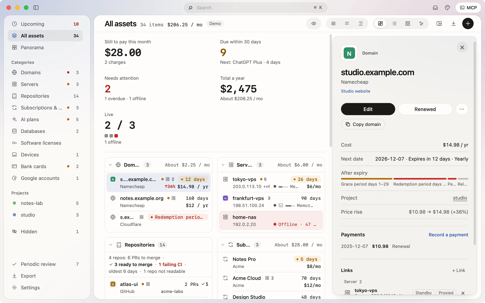 | 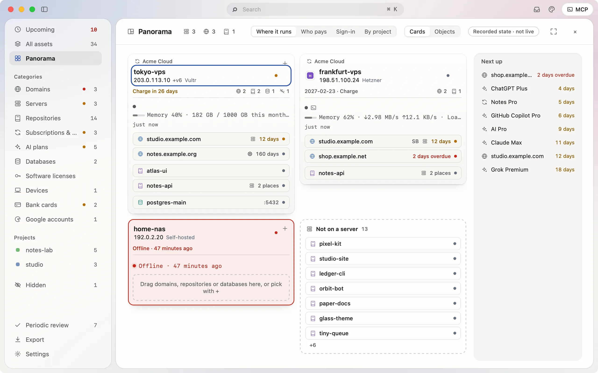 |

---

## Why Assetboard?

If you ship side projects, run VPSes/homelabs, and juggle multiple AI subscriptions, your infrastructure is scattered across registrars, billing emails, `~/.ssh/config`, and browser tabs. Assetboard pulls it all into one fast, native macOS app that never phones home.

- **AI Plan Quotas & Active Coding Sessions** — Reads local usage files and quota endpoints for **Claude Code, Codex, Cursor, GitHub Copilot, Grok CLI, opencode, and Antigravity** (only numbers, model names, and timestamps — never prompts or chats). Shows 5-hour/weekly/monthly bars, reset countdowns, whether your usage is worth the subscription at API rates, and which AI coding sessions are currently running on which repo & branch.
- **Built-in MCP Server & CLI** — Connect Claude Code, Codex, Cursor, or Claude Desktop in one command. Let your AI populate the board from your repos/configs, or ask it what renews next month and which side projects are bleeding money. IPs, SSH hosts, emails, and phones are masked by default; deletions always require your confirmation in the app; every call is logged locally.
- **14 Asset Categories + Panorama + Project Burn Rate** — Track domains (RDAP checks, price-hike badges, grace/redemption windows), servers (SSH/probe live load & Tailscale online status), repos (open PRs, mergeable status & CI runs), databases & free-tier sleep rules, subscriptions, bank cards (last 4 digits only), phone numbers, Apple IDs, Google accounts, and devices. Press `P` for 4 panorama lenses (*where it runs · who pays · sign-in · by project*) or switch to the physical **Object Shelf** drawing.
- **True Local-First & Direct Mac-to-Mac Sync** — Plain SQLite (`assetboard.sqlite`) + JSON mirror (`board.json`) on your Mac; tokens stay in macOS Keychain; the WebView is blocked from the network via CSP; every Swift network request is visible in the built-in **Network Log**. Pair two Macs over LAN or Tailscale for direct encrypted sync with field-level 3-way merge — no cloud server in the middle.
- **Zero-Dependency Native Craft** — Native Swift + vanilla JS/CSS. No `package.json`, no bundler, no third-party runtime dependencies. Free and open source (GPL-3.0) with no accounts, limits, or paywalls.

---

## Connect to Your AI via MCP

Add Assetboard to Claude Code in one line (other MCP clients: copy config from **File › MCP Setup…**):

```sh
claude mcp add assetboard -- /Applications/Assetboard.app/Contents/MacOS/assetboard-cli mcp
```

Then ask your AI:
- *"Scan this project and my configs, and add every domain, server, database, repo, and paid subscription you find to Assetboard. Never record passwords or tokens."*
- *"Read my Assetboard. What renews in the next 60 days, what looks forgotten, and what should I cancel?"*
- *"List each project's monthly cost, revenue, and net. If I shut down the worst one, what do I cancel first?"*

---

## Install & Try Demo in 10 Seconds

1. Download the signed & notarized `.dmg` from **[assetboard.app](https://assetboard.app/)** (requires **macOS 15+**, **Apple Silicon**).
2. Drag **Assetboard** into `Applications`. The app updates itself.
3. Want to explore with fictional data first (touches nothing, no network)?

```sh
open /Applications/Assetboard.app --args --demo
```

Or preview the browser UI locally without building anything:

```sh
python3 -m http.server 4317 --bind 127.0.0.1
# Open http://127.0.0.1:4317/?demo  (add &lang=zh for Chinese)
```

> Release checksums are published in [SHA256SUMS.txt](https://github.com/hippone-labs/assetboard/releases/latest/download/SHA256SUMS.txt). Verify with `shasum -a 256 -c SHA256SUMS.txt --ignore-missing`.

---

## Themes & Views

Choose between **Quiet** (light/dark, hairlines, structured columns) and **Fridge magnets** (4 doors with tilted draggable panels, tape, magnets, and a tiny pixel mascot). Turn on **Privacy mode** (eye icon in the top bar) anytime to mask names, accounts, and IPs for safe screenshots.

| | |
| --- | --- |
| **Quiet · Light** 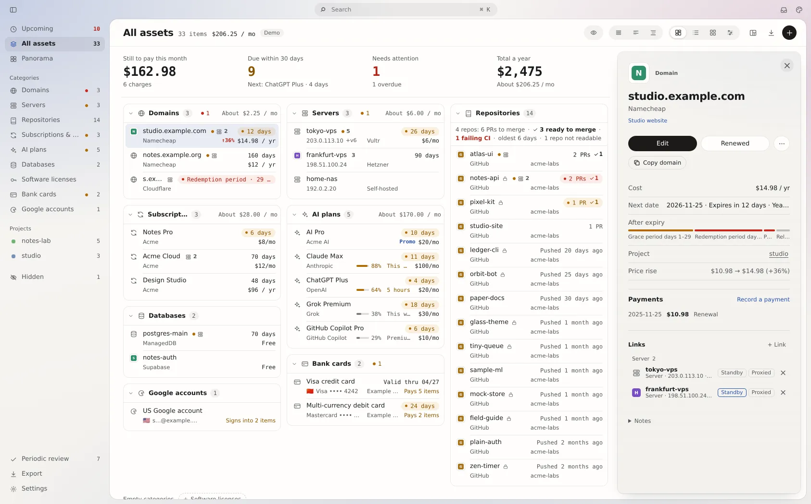 | **Quiet · Dark** 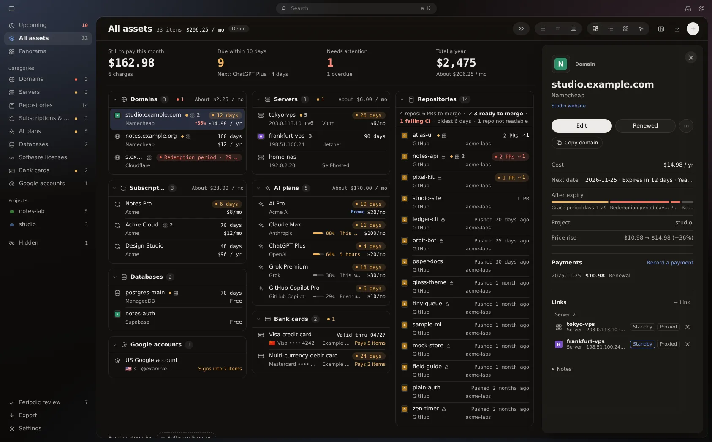 |
| **Fridge · Pixel Kitchen** 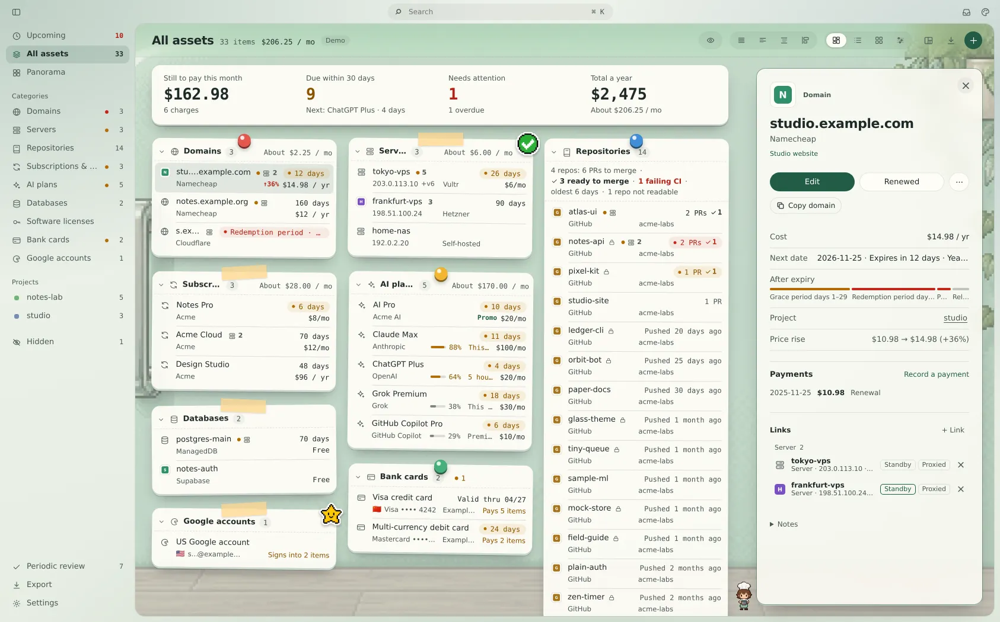 | **Fridge · Pixel Night City** 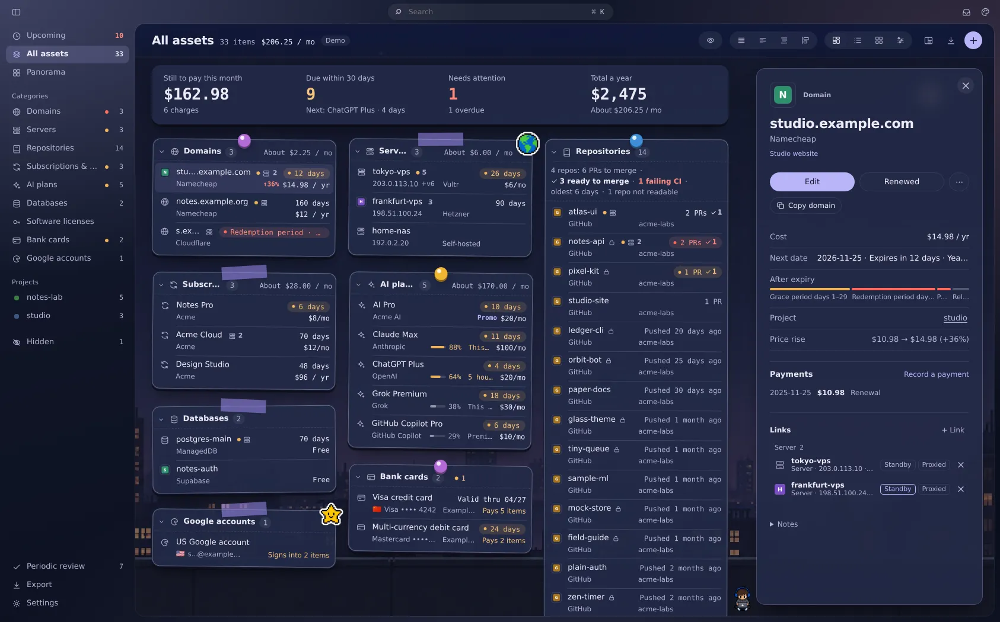 |
| **Fridge · Sketchbook Fridge** 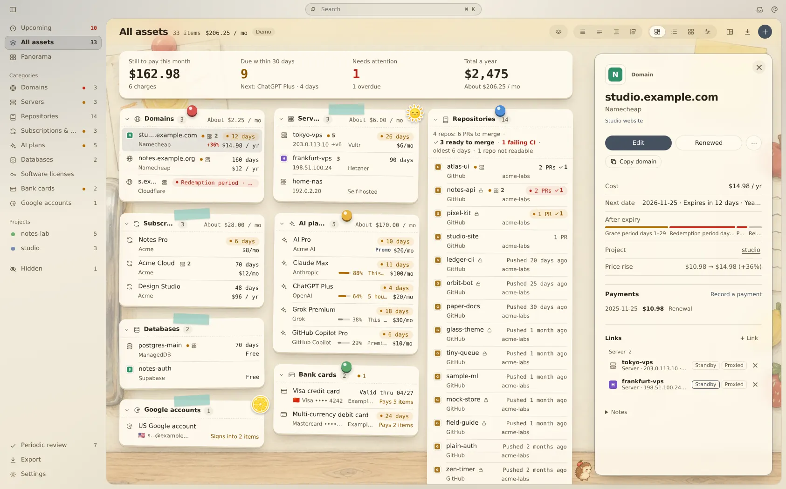 | **Fridge · Pixel Server Room** 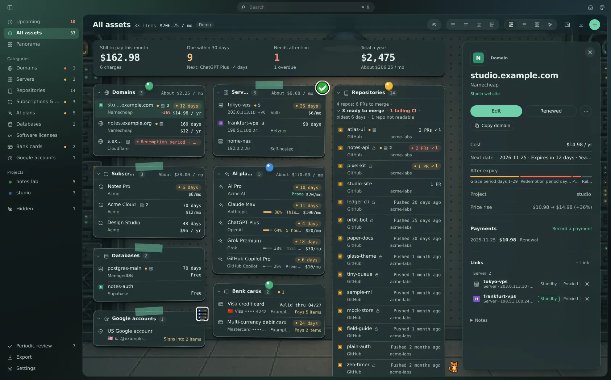 |

### More views

| | |
| --- | --- |
| **Upcoming**: overdue, 7d/30d charges, renewals to confirm 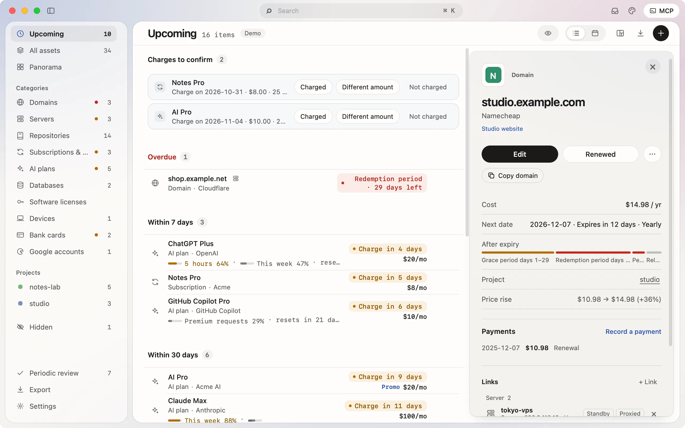 | **Cost**: monthly/yearly totals in 6 currencies + 12-month forecast 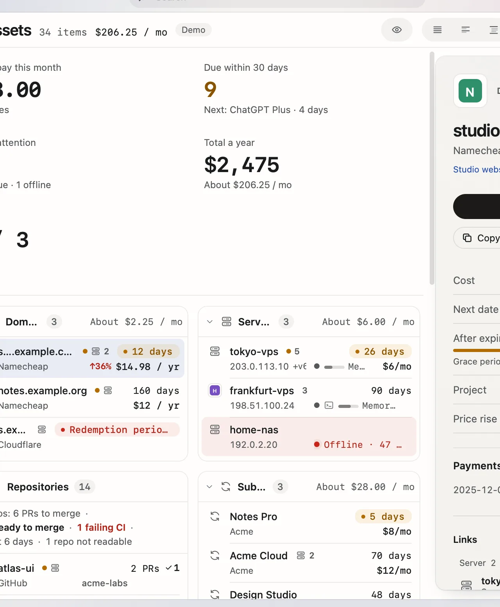 |
| **Timeline**: 12 months of renewals and recurring charges 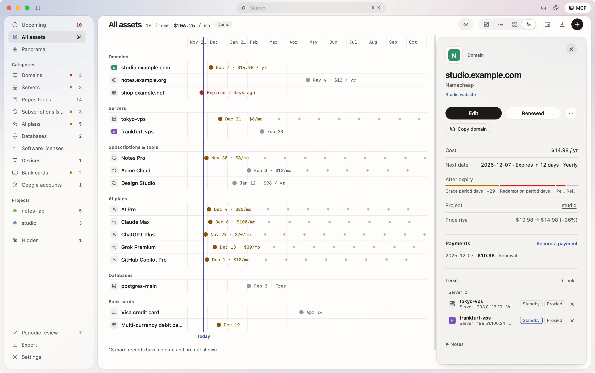 | **Live status** (off by default): SSH/probe memory, traffic & load 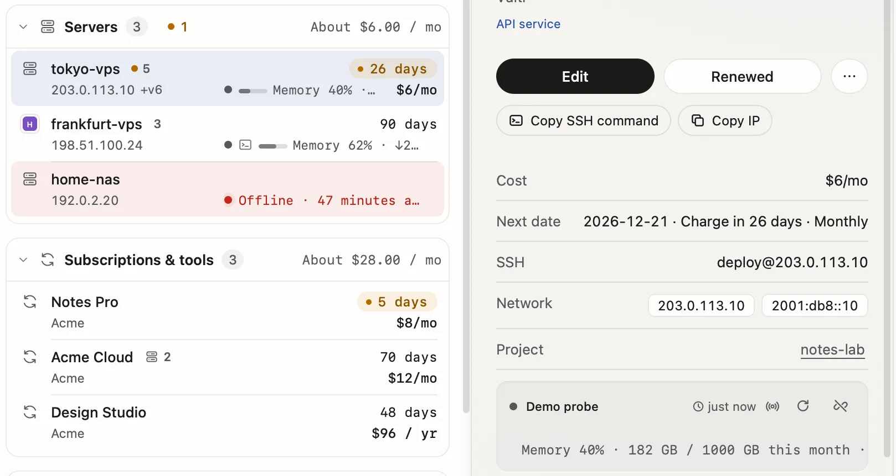 |

---

## Reminders, Imports & Integrations

### Native macOS notifications (even when closed)
- **Expiries & renewals**: 30, 7, and 1 days ahead at 09:00.
- **Monthly charges, trial ends, cancel-by dates**: 3 and 1 days ahead.
- **One-off expiries & SIM/number keep-alives**: on the day, plus day +3 and day +14.
- **Auto-renewals**: never silently roll forward — asks you to confirm *"Renewed"* or *"Not renewed"* in Upcoming.

### Data sources (12+ ways to populate)

| Source | Details | Platform |
| --- | --- | --- |
| **Paste a domain / URL** | Queries RDAP for expiry date and registrar (TLDs without RDAP like `.cn`/`.io`/`.de` filled manually) | Mac App |
| **Cloudflare** | Read-only token: Zones, Pages, Workers, R2 (+ expiry dates for Cloudflare Registrar domains) | Mac App |
| **GitHub** | Local `gh` or read-only token: repos, open PRs, mergeable status, branches & latest Actions | Mac App |
| **`~/.ssh/config`** | Host, HostName, User, Port (ignores `github.com` / `User git`) | Mac App |
| **Tailscale** | Local `tailscale status --json`: import tailnet machines as servers/devices + optional online status | Mac App |
| **Registrars & Cloud** | Namecheap, Porkbun, Hetzner, DigitalOcean, Vercel *(not yet verified against live accounts)* | Mac App |
| **Screenshots & PDFs** | On-device macOS Vision OCR | Mac App |
| **Mail & renewal notices** | `.eml` files or pasted text, rule-parsed with preview | App & Browser |
| **CSV / TSV / JSON** | File drop or pasted tables, previewed before writing | App & Browser |
| **Your own AI model** | Claude, OpenAI-compatible API, or local Ollama to parse screenshots/mail/text | Mac App |
| **Inbox folder** | Drop script-generated JSON into `~/Library/Application Support/Assetboard/Inbox/` | Mac App |

<details>
<summary>Scriptable Inbox JSON format (max 100 items, 1 MB)</summary>

Write to a temporary filename first, then rename to `.json` inside `~/Library/Application Support/Assetboard/Inbox/` (or drag onto the window). Every file is previewed before writing:

```json
{"assetboard": 1, "items": [
  {"name": "example.com", "type": "domain", "provider": "Namecheap", "account": "me@example.com",
   "date": "2027-03-01", "dateKind": "expire", "cycle": "yearly", "cost": "$10.98 / year",
   "url": "https://ap.www.namecheap.com", "notes": "", "purpose": ""}
]}
```

</details>

### Also included
- **Exports**: JSON backup, calendar `.ics`, payment ledger `.csv`, and a standalone **Handover List `.html`**.
- **Free-tier sleep rules**: Built-in vendor rules (Supabase, Render, Upstash, etc.) + optional GitHub Actions keep-alive config.
- **This Mac & paired Macs**: Automatic hardware/disk/battery/serial record for this Mac; pair additional Macs over LAN or Tailscale (6-digit confirmation) for encrypted board sync and remote coding session status.
- **Custom combined views**: Group categories into custom views (e.g. *Machines* = Servers + Devices).
- **Keyboard-first**: Single-key shortcuts everywhere (`?` lists all). English (default) & Simplified Chinese.

---

## Privacy & Network Transparency

- **Storage**: `~/Library/Application Support/Assetboard/assetboard.sqlite` + `board.json`. No account, no cloud sync, no telemetry.
- **Secrets**: Tokens and API keys live in the **macOS Keychain**. Bank card forms refuse full card numbers (last 4 digits only).
- **CSP isolation**: The WebView cannot make network requests directly; every request goes through Swift and is recorded in the **Network Log**.
- **Default connections**: Update checks (`assetboard.app`), known provider favicons, ECB exchange rates (`api.frankfurter.dev`), connected Cloudflare accounts, and local AI tool quota endpoints (using each tool's own login; each toggleable off). Everything else only connects when you enable or trigger it. See [GUIDE.md](GUIDE.md#隐私与网络) for the full host list.

---

## Build from Source

No `package.json`, bundler, or third-party dependencies. This repository is the complete source of the official release.

```sh
./desktop/build.sh        # Builds dist/Assetboard.app (ad-hoc signed) & runs native self-tests (macOS + Xcode CLT)
node --test               # Runs pure-JS unit tests (Node 22+, zero packages)
```

<details>
<summary>Prerequisites & repository layout</summary>

| Need | Version | For |
| --- | --- | --- |
| macOS & chip | Apple Silicon (`arm64`), macOS 15.0+ (`LSMinimumSystemVersion`) | Building and running the app |
| Xcode / Swift | Xcode Command Line Tools (`swiftc`); full Xcode only needed to recompile `Assets.car` | `./desktop/build.sh` |
| Node | Verified on Node 22 (`node --test`, no packages needed) | Unit tests |
| Python 3 | Any recent Python 3 (no packages needed) | Local browser server & `tools/` tests |
| Playwright | Optional: `npm install --no-save playwright && npx playwright install chromium`, then `node tools/browser-tests.js` | UI tests (`tests/*.playwright.js`) |

| Path | Contents |
| --- | --- |
| `index.html`, `*.js`, `*.css` | Shared UI; pure logic in `asset-data.js` |
| `desktop/` | Native macOS app (Swift), CLI/MCP, packaging scripts |
| `pro/` | Open-source GPL-3.0 modules (bulk MCP edits, weekly RDAP, 12h Cloudflare sync, live status) bundled in all standard builds |
| `i18n/` | English localization |
| `tests/` | Node unit tests and Playwright UI tests |
| `GUIDE.md`, `OBJECT-PANORAMA.md`, `DEVICE-PAIRING.md` | Detailed documentation (Chinese) |

</details>

---

## Contributing & License

Bug reports, **provider expiry/grace-period rules**, and PRs are very welcome — see [CONTRIBUTING.md](CONTRIBUTING.md) or open an [issue](https://github.com/hippone-labs/assetboard/issues/new/choose). Contact: `lihaosong1109@gmail.com`.

Licensed under **[GPL-3.0](LICENSE)**.

<div align="center">

If Assetboard keeps your domains, servers, and AI subscriptions under control, consider giving it a **Star** — it helps other developers discover the project.

</div>
