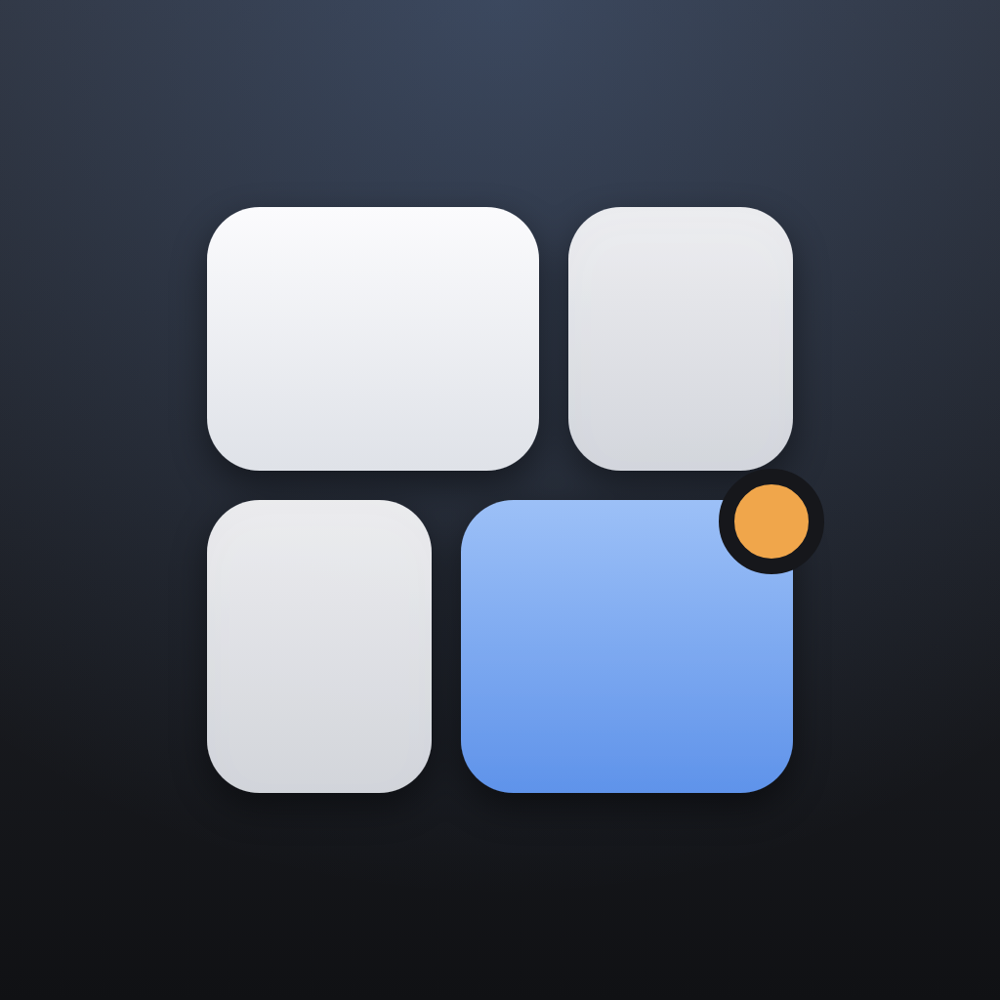
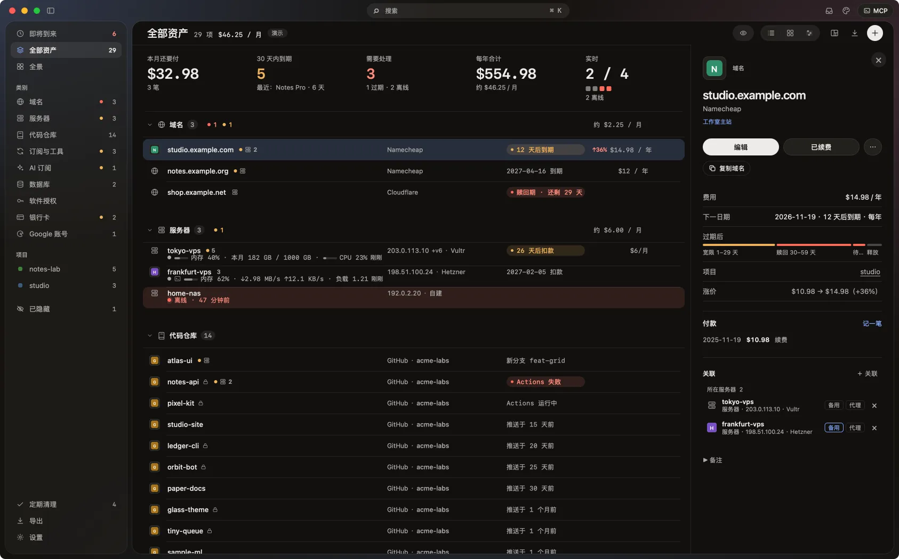
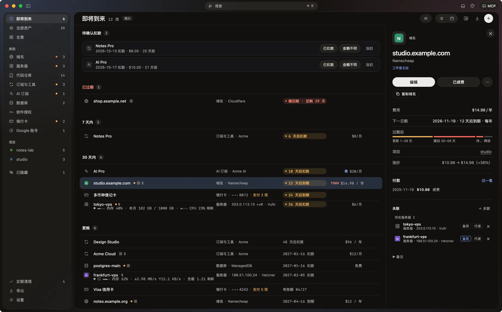
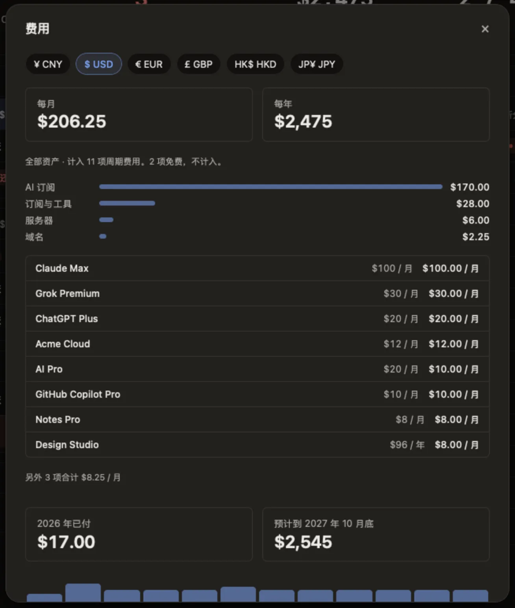
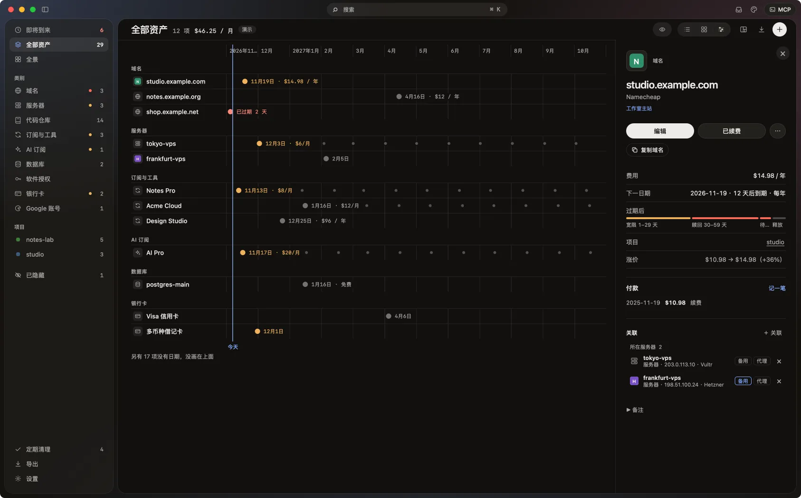
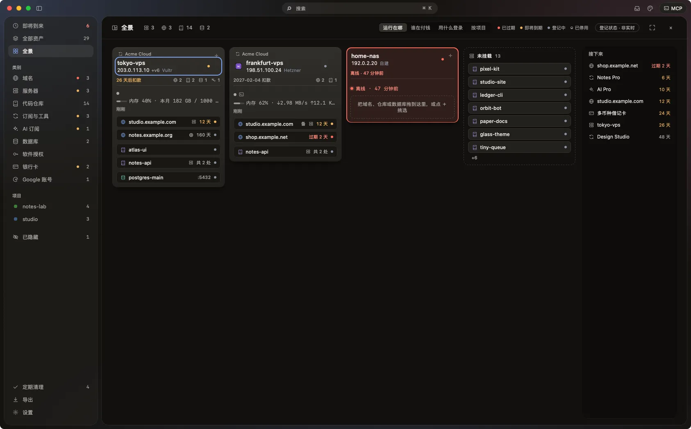
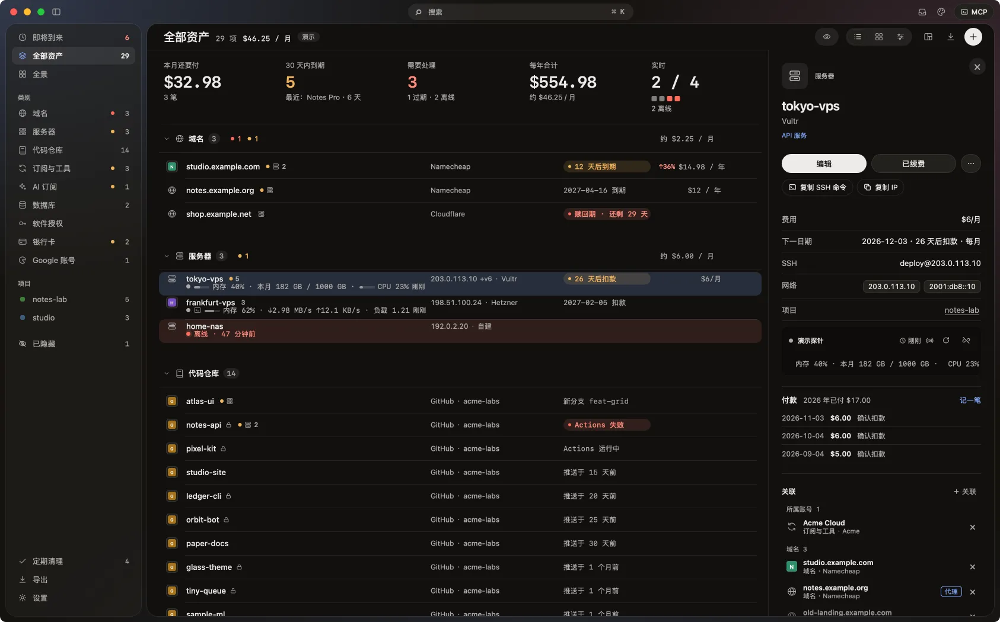
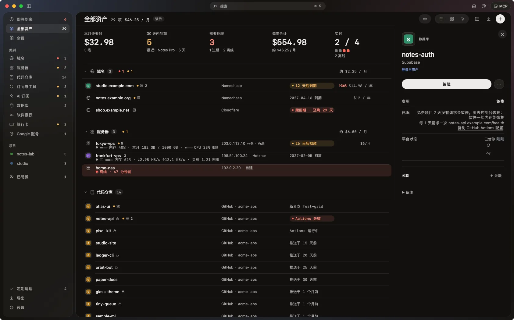

<div align="center">



# Assetboard

记录域名、服务器、代码仓库、订阅等数字资产的到期日、费用和相互关系的 macOS App。

[](https://github.com/hippone-labs/assetboard/actions/workflows/build.yml)
[](LICENSE)
[](https://assetboard.app/zh/)
[](https://assetboard.app/zh/)

[官网](https://assetboard.app/zh/) · [使用手册](GUIDE.md) · [English](README.en.md) · [问题反馈](https://github.com/hippone-labs/assetboard/issues/new/choose)

</div>



<sub>截图来自演示模式，数据是虚构的。</sub>

## 目录

- [概述](#概述)
- [记录什么](#记录什么)
- [界面](#界面)
- [数据来源](#数据来源)
- [其他功能](#其他功能)
- [免费版与 Pro](#免费版与-pro)
- [数据与网络](#数据与网络)
- [安装](#安装)
- [从源码构建](#从源码构建)
- [参与](#参与)
- [许可证](#许可证)

## 概述

Assetboard 是一个本地 App：每条资产记下一个日期（到期、自动续费扣款、试用结束或取消截止，可以按月或按年重复）、费用、平台、账号和管理链接，资产之间可以建立关联。App 按这些日期排出待办、发系统通知，按费用算出合计。

数据存在本机的 SQLite 文件里，不需要账号。界面是一套 HTML/CSS/JS，Mac App 用 WKWebView 加载它，同一套页面也能直接在浏览器里运行（功能少一些）。界面默认英文，可在「设置」里换成简体中文。

## 记录什么

13 个类别：域名、服务器、代码仓库、部署服务、数据库、对象存储、订阅与工具、AI 订阅、软件授权、银行卡、手机号、Apple ID、Google 账号。

- 服务器可以记最多 4 个 IP、SSH 主机、用户和端口。
- 银行卡只记尾号、卡组织和有效期，表单不接受完整卡号。
- 关联的含义由两边的类别决定：域名指向服务器或部署，仓库部署到部署服务，银行卡支付订阅，Apple ID / Google 账号用于登录，手机号接收验证码。
- 资产可以归到一个或几个项目，项目里的资产合起来算整个项目的花费：每月合计、按类别拆分、未来 12 个月；填上每月收入就能看净额，几个项目共用的按比例分摊。

## 界面

左边是侧边栏：即将到来、全部资产、全景、各类别、项目、已隐藏。中间是磁贴墙（每个类别一块面板，密度分三档），右边是选中资产的详情。可以切成列表、网格或 12 个月的时间线，即将到来可以切成月历。

| | |
| --- | --- |
| 即将到来：按已过期、7 天内、30 天内、更晚分组  | 费用：每月和每年合计，按类别拆分，可换计价币种  |
| 时间线：从本月起 12 个月的到期和扣款  | 全景：每台服务器一张卡，列出挂在上面的资产  |
| 实时状态（Pro，默认关闭）：服务器的内存、流量和负载  | 免费套餐的休眠规则和保活配置  |

全景有四个视角：运行在哪、谁在付钱、用什么登录、按项目。拖动卡片里的资产或按 `L` 修改关联。

## 数据来源

| 来源 | 平台 |
| --- | --- |
| 手动添加：选类别后填表 | App、浏览器 |
| CSV / TSV / JSON 文件或粘贴的表格，先预览再写入 | App、浏览器 |
| `.eml` 邮件和粘贴的续费通知，按规则识别后逐条确认 | App、浏览器 |
| 截图和 PDF，用 macOS 的文字识别在本机识别 | App |
| Cloudflare（只读 API 令牌）：Zone、Pages、Workers、R2 | App |
| GitHub（本机 `gh` 或只读令牌）：仓库 | App |
| `~/.ssh/config`：Host、HostName、User、Port；github.com 这类代码托管（或 `User git`）不当作服务器 | App |
| 自己配置的 AI 模型（Claude、OpenAI 兼容接口或 Ollama）识别截图、邮件和文字 | App |

每种导入方式的细节见[使用手册 · 导入方式](GUIDE.md#导入方式)。

脚本可以把下面格式的 JSON 放进 `~/Library/Application Support/Assetboard/Inbox/`，或拖进窗口，每次都在导入预览里确认。先写成临时名，写完再改名为 `.json`；一份最多 100 项、1 MB，其余字段忽略：

```json
{"assetboard": 1, "items": [
  {"name": "example.com", "type": "domain", "provider": "Namecheap", "account": "me@example.com",
   "date": "2027-03-01", "dateKind": "expire", "cycle": "yearly", "cost": "$10.98 / 年",
   "url": "https://ap.www.namecheap.com", "notes": "", "purpose": ""}
]}
```

## 其他功能

- 系统通知：到期前 30、7、1 天；按月扣款、试用结束和取消截止前 3、1 天。
- 自动续费到了扣款日，在即将到来里等你确认是否扣款。
- 续费记录、付款记录和价格变动。
- 通过 RDAP 核对域名在注册局的到期日和状态；粘贴一个域名、网址或一串域名就新建记录，到期日和注册商从注册局填。
- 导出：JSON 备份（可以导回）、日历 .ics、付款账本 .csv、交接清单 .html。
- 隐私模式：遮住名称、账号和 IP。
- 网络记录：列出 App 发出的每个请求。
- MCP 服务和命令行 `assetboard-cli`，供 Claude Code、Codex、Cursor 等工具读写资产，见[使用手册 · MCP 接入](GUIDE.md#mcp-接入外部-ai-工具与命令行)。每次外部调用都记在本机的 MCP 操作记录里（哪个客户端、什么时间、调了哪个工具、改了什么），在「设置 › MCP」查看。
- AI 额度与用量：从本机的 Claude Code、Codex、Cursor、GitHub Copilot、Grok CLI、opencode、Antigravity 的文件读出额度和用量，显示在对应的 AI 订阅上：快用完、闲置、按 API 价折算值不值。只读数字、模型名和时间。
- 代码仓库（Mac，默认关闭）：GitHub 同步时一并读取分支和最近一次 Actions，失败或运行中的排在行首，新分支显示 14 天。
- 键盘操作，按 `?` 查看快捷键，见[使用手册 · 快捷键](GUIDE.md#快捷键)。
- 主题色、两种磁贴墙皮肤（安静；冰箱贴：四扇冰箱门可选，整个窗口跟着门的配色，面板可以随手摆放）、三档密度，浅色和深色跟随系统；界面有英文（默认）和简体中文。

## 免费版与 Pro

免费版不限时间和条数。Pro 是 US$10 一次买断的许可证，在本机离线验证。

| 免费 | Pro |
| --- | --- |
| 资产板、即将到来、本机提醒、待确认续费和扣款 | 外部 AI 工具修改和删除已有资产（MCP 和命令行） |
| 付款账本、未来 12 个月预测、价格变动 | 每周自动核对注册局 |
| 项目、收入与分摊、关停清单、定期清理 | Cloudflare 每 12 小时自动同步，新资产出现时提醒 |
| 全部导入、接 Cloudflare、GitHub、Namecheap、Porkbun、Hetzner、DigitalOcean、Vercel 后挑选和手动同步、自配 key 的 AI 识别 | 实时状态（SSH 直读、监控面板、平台状态） |
| MCP 和命令行 `assetboard-cli`：查询、添加（同名跳过）、引入待引入；Inbox 文件夹 | 即将推出：加密快照、「如果我出事」接手包 |
| 关联、全景、AI 额度与用量、隐私模式、网络记录、备份和导出 | |

这个仓库是免费部分的全部代码，自己编译得到的版本和没有许可证的官方安装包功能一样。Pro 的模块不在这个仓库里，只在官方安装包里。购买和激活见[使用手册](GUIDE.md#pro-的购买与激活)。

## 数据与网络

- 数据在 `~/Library/Application Support/Assetboard/`：`assetboard.sqlite`，另有 JSON 镜像 `board.json`。没有云同步和遥测。
- 令牌和 API key 存在 macOS 钥匙串。
- App 自己会连的主机：检查更新（assetboard.app）、已知平台的网站图标、汇率（api.frankfurter.dev）、连上之后的 Cloudflare。其余连接（RDAP、AI、AI 工具的额度接口、实时状态、GitHub、Namecheap、Porkbun、Hetzner、DigitalOcean、Vercel）在你打开或点击之后才发生。
- 网页本身由 Content-Security-Policy 禁止联网，所有请求经过 Swift 一侧，记在网络记录里。
- 交给外部 AI 工具的数据默认遮住 IP、主机、手机号和邮箱，不含银行卡和手机号两类记录。

完整的主机列表见[使用手册 · 隐私与网络](GUIDE.md#隐私与网络)。

## 安装

从 [assetboard.app](https://assetboard.app/zh/) 下载 `.dmg`，把 Assetboard 拖进「应用程序」。需要 macOS 15 或更高、Apple Silicon。安装包已签名并公证，App 内置更新。

用演示数据启动（不读写你的数据，不联网）：

```sh
open /Applications/Assetboard.app --args --demo
```

## 从源码构建

没有 package.json、打包工具或第三方依赖。

```sh
./desktop/build.sh        # 输出 dist/Assetboard.app（本机临时签名）并跑原生自检；需要 macOS 和 Xcode 命令行工具
node --test               # 单元测试
```

浏览器版不需要构建，数据存在浏览器的 localStorage，没有系统通知、文字识别、AI 识别和钥匙串：

```sh
python3 -m http.server 4317 --bind 127.0.0.1    # 打开 http://127.0.0.1:4317，加 ?demo 看演示数据
```

| 路径 | 内容 |
| --- | --- |
| `index.html`、`*.js`、`*.css` | 两种宿主共用的界面；纯函数在 `asset-data.js`，有单元测试 |
| `desktop/` | macOS App（Swift）和构建、打包脚本 |
| `i18n/` | 英文文案 |
| `tests/` | Node 单元测试和 Playwright 界面测试 |
| `GUIDE.md` | 使用手册 |

## 参与

问题、服务商规则（比如某家云服务器过期几天后释放）和建议可以用 [issue 表单](https://github.com/hippone-labs/assetboard/issues/new/choose)提交，也欢迎 Pull Request，见 [CONTRIBUTING.md](CONTRIBUTING.md)。邮件：assetboard@163.com。

## 许可证

[GPL-3.0](LICENSE)。
