<div align="center">


# Assetboard

**面向独立开发者与 AI 时代开发者的本地数字资产中控台（macOS）。**

把域名续费与涨价、服务器实时负载、Claude Code / Codex / Cursor 额度与回本折算、GitHub 待合并 PR、银行卡和副业项目盈亏，全部铺在一块安静磁贴墙或像素冰箱门上。内置 MCP、局域网/Tailscale 加密同步、纯本地零云端、无遥测。

[](https://github.com/hippone-labs/assetboard/stargazers)
[](https://github.com/hippone-labs/assetboard/releases/latest)
[](https://assetboard.app/zh/)
[](LICENSE)
[](https://github.com/hippone-labs/assetboard/actions/workflows/build.yml)

**[官网下载](https://assetboard.app/zh/)** · **[English](README.md)** · **[完整使用手册](GUIDE.md)** · **[问题反馈](https://github.com/hippone-labs/assetboard/issues/new/choose)**

</div>

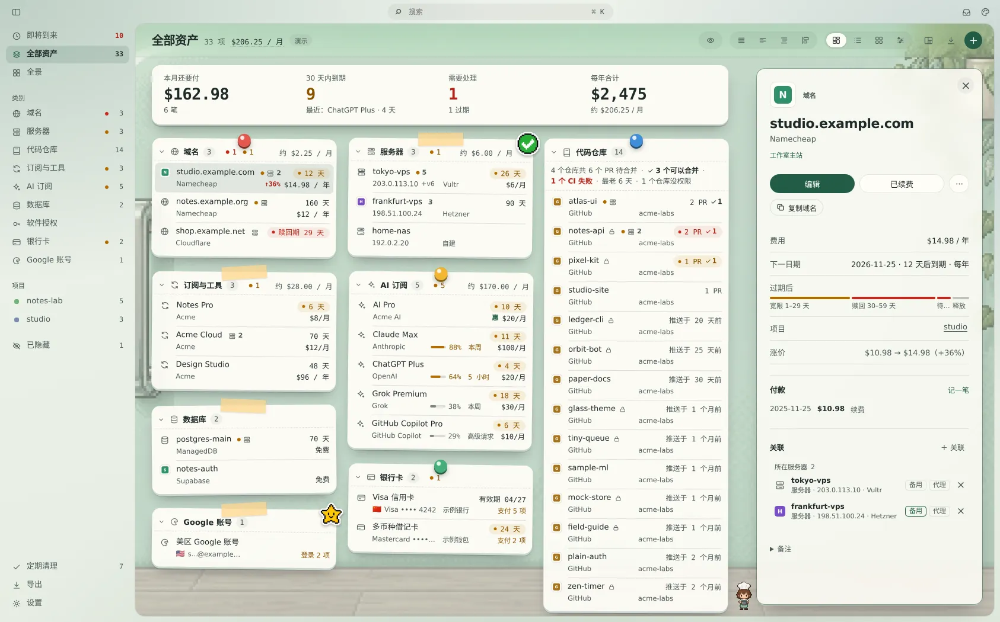

<sub>冰箱贴皮肤（像素厨房）的演示模式截图，数据为虚构。支持 4 扇冰箱门皮肤与极简浅/深色「安静」模式随时切换。</sub>

| 安静模式：磁贴墙 + 详情检查器 | 全景视图：每台服务器挂着哪些资产（按 `P`） |
| --- | --- |
| 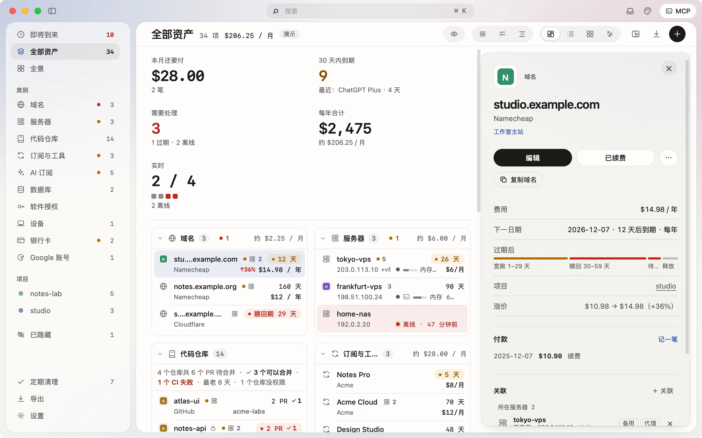 | 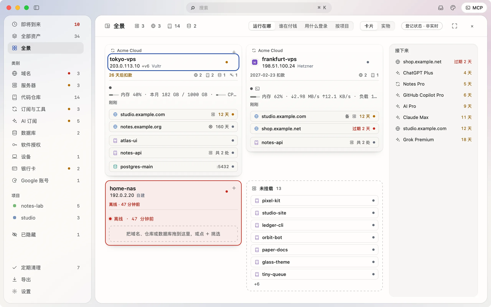 |

---

## 为什么做 Assetboard？

做独立开发、折腾 VPS/Homelab、同时开好几个 AI 编程订阅时，资产很快就会散落在注册商、账单邮件、`~/.ssh/config` 和记事本里。Assetboard 把它们统一收进一个纯本机运行的原生 macOS App：

- **AI 订阅额度 & 本机编码会话监控** — 读取本机 **Claude Code、Codex、Cursor、GitHub Copilot、Grok CLI、opencode、Antigravity** 的用量文件与额度接口（只读数字、模型名和时间，不读对话内容）。直接显示 5 小时/本周/本月进度条、重置倒计时、按 API 价折算值不值订阅价，以及本机正在跑的 AI 编码会话在哪个仓库和分支。
- **内置 MCP 服务器与命令行** — 一行命令接入 Claude Code、Codex、Cursor 或 Claude Desktop，让 AI 帮你将项目配置自动录入资产板，或直接问它“下个月有哪些要续费、哪个副业项目最亏钱、哪些订阅该砍”。IP、SSH 主机、邮箱和手机号默认遮罩，删除一律需要你在 App 里确认，每次调用都记在本机 MCP 操作记录里。
- **14 类数字资产 + 全景关系 + 项目盈亏** — 覆盖域名（RDAP 核对、涨价提示、宽限/赎回期进度条）、服务器（SSH/探针实时负载、Tailscale 在线状态）、代码仓库（待合并 PR、可合并状态与 Actions）、数据库（免费套餐休眠与保活规则）、订阅、银行卡（只记尾号）、手机号保号、Apple ID、Google 账号、设备。按 `P` 切换四个全景视角（*运行在哪 · 谁在付钱 · 用什么登录 · 按项目*），还可切成「实物货架」画法（[画法说明](OBJECT-PANORAMA.md)）。
- **真正本地优先 + Mac 间直连加密同步** — 数据只存在本机 SQLite（`assetboard.sqlite`）与 JSON 镜像（`board.json`），令牌存在 macOS 钥匙串；网页层由 CSP 禁止联网，所有 Swift 请求记在内置**网络记录**里。两台 Mac 可通过局域网或 Tailscale 直接配对加密同步（按字段三方合并、列出冲突），不经过任何服务器。
- **零第三方依赖的原生克制** — 原生 Swift + 纯 JS/CSS，没有 `package.json`、没有打包工具、没有第三方运行依赖。永久免费、GPL-3.0 开源、不限条数、无需账号。

---

## 一行命令接入 AI（MCP）

[](https://glama.ai/mcp/servers/hippone-labs/assetboard)

把 Assetboard 接入 Claude Code（其他客户端在 App 菜单「文件 › MCP 接入…」一键复制配置）：

```sh
claude mcp add assetboard -- /Applications/Assetboard.app/Contents/MacOS/assetboard-cli mcp
```

接好后可以直接这样问你的 AI：
- *“扫描这个项目和你知道的配置，把所有域名、服务器、数据库、代码仓库和付费订阅加进 Assetboard，不要记录密码和令牌。”*
- *“读一下我的 Assetboard：未来 60 天哪些要扣款？哪些资产像是被忘了还在烧钱？给我一份续费/取消清单。”*
- *“列出每个副业项目的月度成本、收入和净额；如果停掉最亏的那个，先取消哪些域名、服务器和订阅？”*

---

## 10 秒上手 & 演示模式

通过 **Homebrew** 一行安装（自动装好 `Assetboard.app` 并把 `assetboard-cli` 链接到 `PATH`；需要 **macOS 15+**，**Apple 芯片**）：

```sh
brew install --cask hippone-labs/tap/assetboard
```

也可以直接从 **[assetboard.app](https://assetboard.app/zh/)** 下载已签名并公证的 `.dmg`，拖进「应用程序」即可（内置自动更新；界面默认英文，可在「设置」切简体中文）。

想先用虚构数据体验（不读写你的数据，不联网）：

```sh
open /Applications/Assetboard.app --args --demo
```

或者直接用浏览器体验界面（无需构建）：

```sh
python3 -m http.server 4317 --bind 127.0.0.1
# 打开 http://127.0.0.1:4317/?demo&lang=zh
```

> 发布页附带 [SHA256SUMS.txt](https://github.com/hippone-labs/assetboard/releases/latest/download/SHA256SUMS.txt)，可用 `shasum -a 256 -c SHA256SUMS.txt --ignore-missing` 核对安装包。

---

## 主题与视图

内置**安静**（浅色/深色、细线分栏）与**冰箱贴**（4 扇门、可随意拖拽摆放的面板、胶带图钉与像素小人）两种风格。顶栏小眼睛一键开启**隐私模式**，遮罩名称、账号与 IP，放心截图分享。

| | |
| --- | --- |
| **安静 · 浅色** 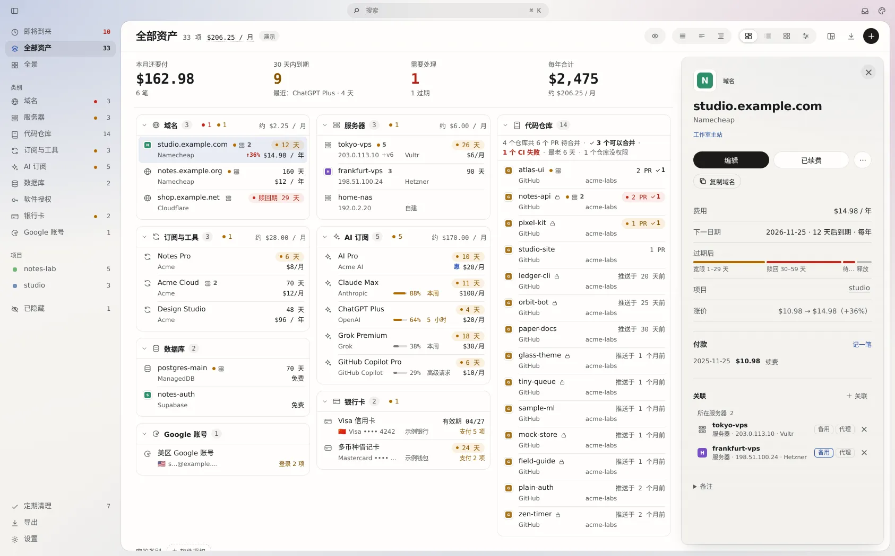 | **安静 · 深色** 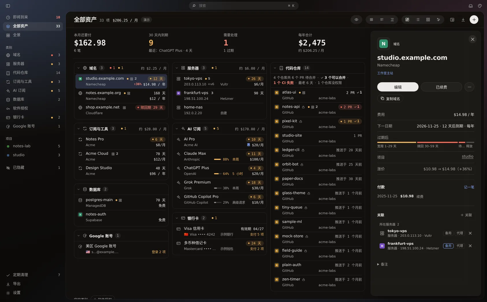 |
| **冰箱贴 · 像素厨房**  | **冰箱贴 · 像素夜景** 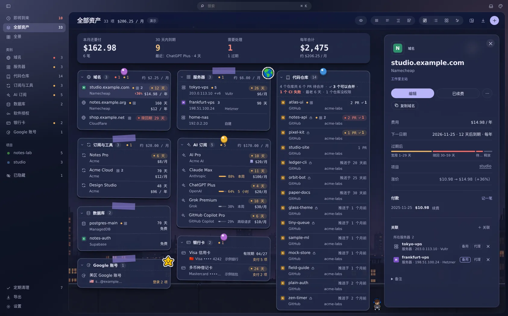 |
| **冰箱贴 · 手绘冰箱门** 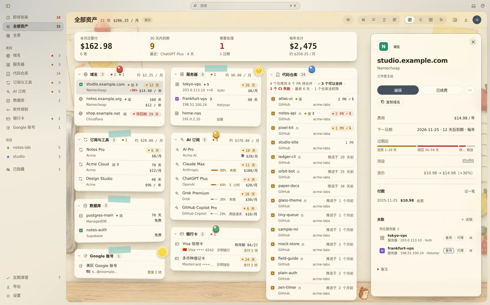 | **冰箱贴 · 像素机房** 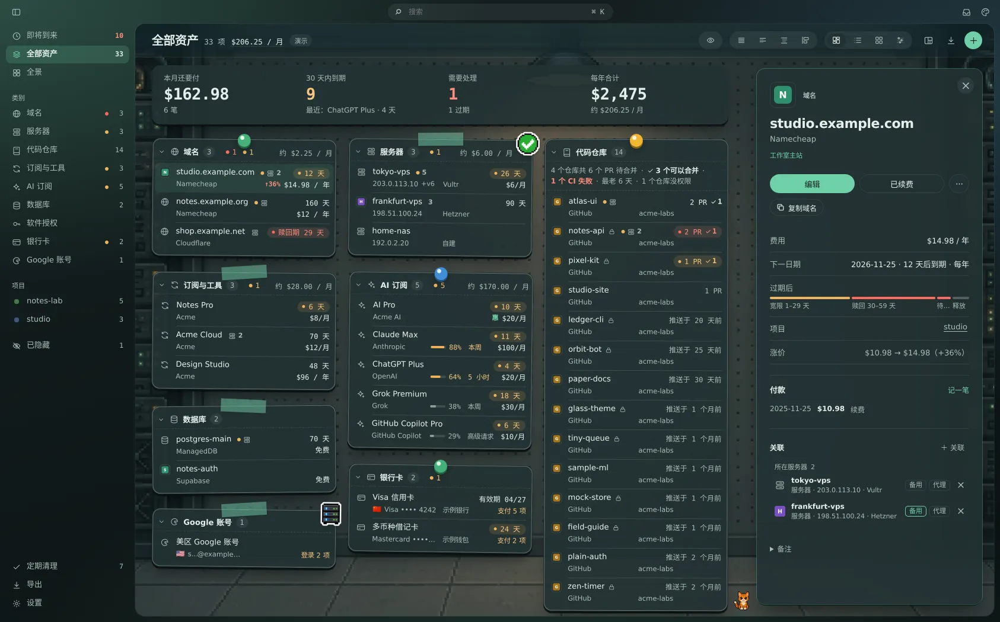 |

### 更多视图

| | |
| --- | --- |
| **即将到来**：待确认扣款、已过期域名、7 天/30 天内扣款 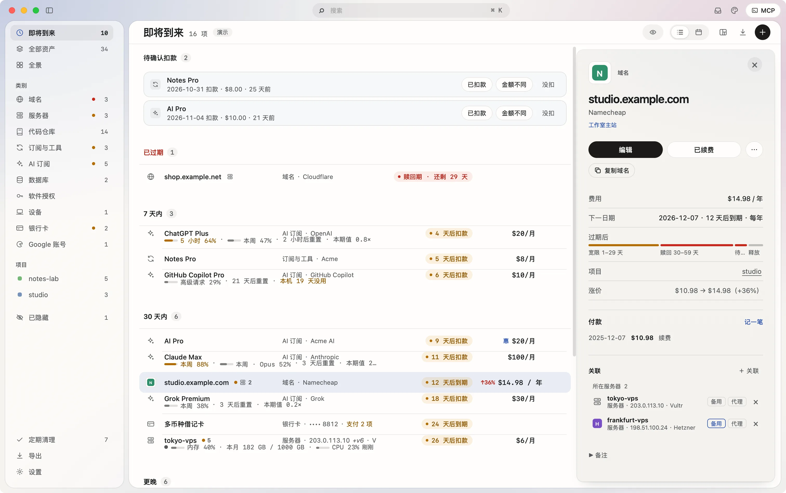 | **费用面板**：6 种币种按月/年汇总 + 未来 12 个月预测 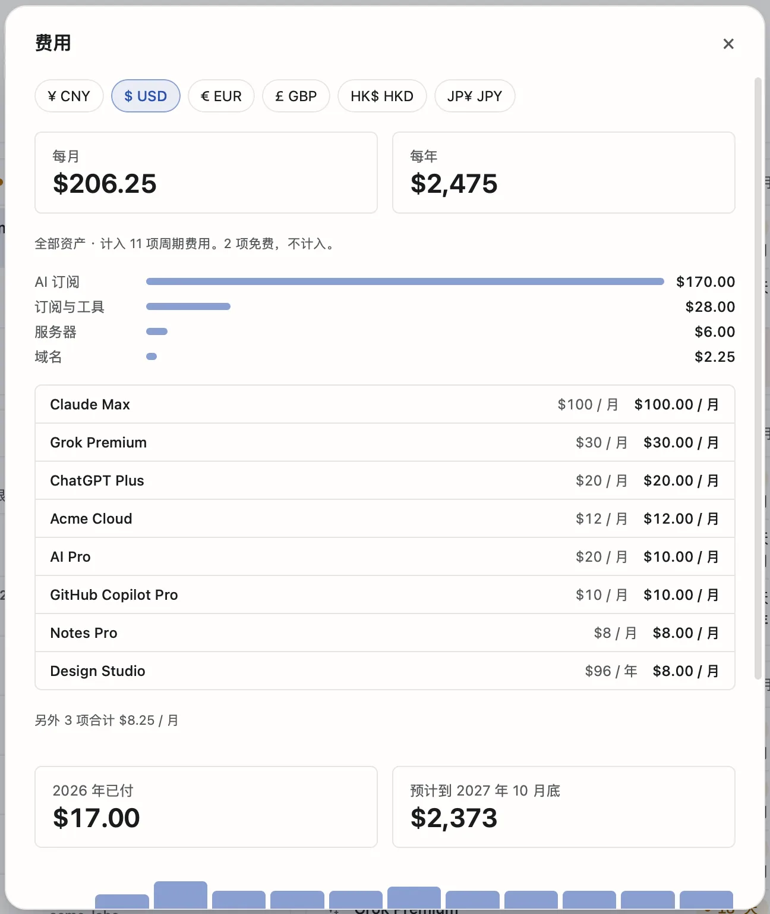 |
| **时间线**：从本月起 12 个月的到期与扣款总览 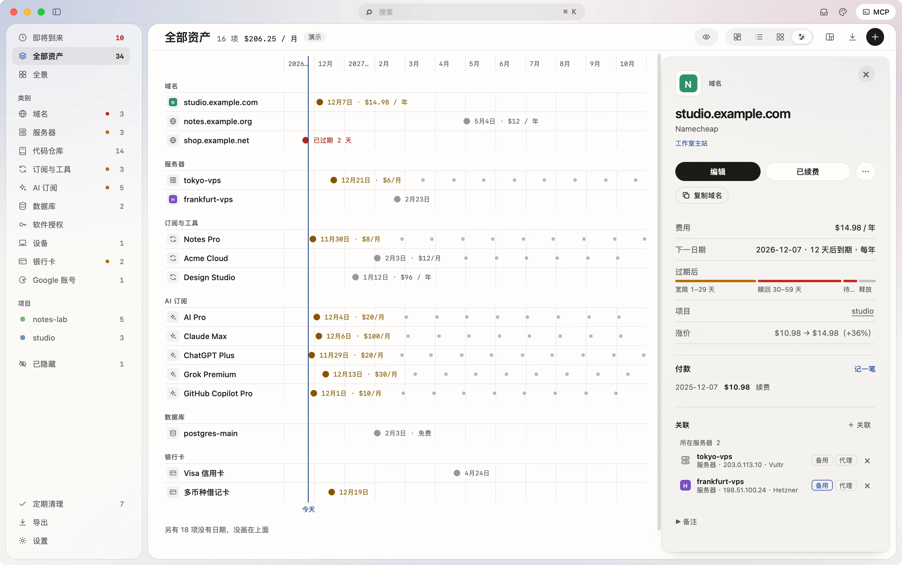 | **实时状态**（默认关闭）：服务器内存、流量和负载 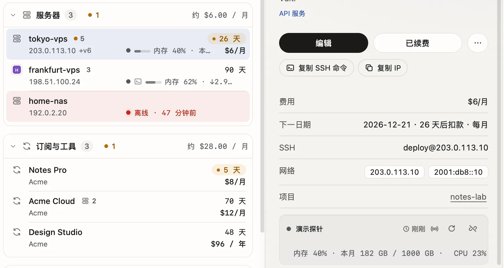 |

---

## 提醒机制与数据来源

### 本机系统通知（窗口关闭也会弹）
- **到期和扣款**：提前 30、7、1 天，早上 9 点通知。
- **按月扣款、试用结束、取消截止**：提前 3、1 天通知。
- **一次性到期和保号期限**：当天、过期第 3 天和第 14 天再提醒一次。
- **自动续费**：到期后不会悄悄滚到下一年，而是留在「待确认续费」里等你点「已续上」或「没续上」。

### 12+ 种数据导入方式

| 来源 | 说明 | 平台 |
| --- | --- | --- |
| **粘贴域名或网址** | 自动通过 RDAP 查询到期日与注册商（`cn`/`io`/`de` 等无 RDAP 后缀手动补填） | Mac App |
| **Cloudflare** | 只读 API 令牌导入 Zone、Pages、Workers、R2（含 Registrar 读权限时带到期日） | Mac App |
| **GitHub** | 本机 `gh` 或只读令牌导入仓库、待合并 PR、可合并状态、分支与最新 Actions | Mac App |
| **`~/.ssh/config`** | 导入 Host、HostName、User、Port（自动忽略 `github.com` / `User git`） | Mac App |
| **Tailscale** | 本机 `tailscale status --json` 一键导入 tailnet 机器，可选显示在线/离线状态 | Mac App |
| **注册商与云平台** | Namecheap、Porkbun、Hetzner、DigitalOcean、Vercel *（尚未用真实账号验证）* | Mac App |
| **截图和 PDF** | 本机 macOS Vision OCR 文字识别 | Mac App |
| **邮件与续费通知** | `.eml` 文件或粘贴文本，规则解析后逐条确认 | App & 浏览器 |
| **CSV / TSV / JSON** | 拖入文件或粘贴表格，先预览再写入 | App & 浏览器 |
| **自定义 AI 模型** | 接 Claude、OpenAI 兼容接口或本地 Ollama 识别截图/邮件/文本 | Mac App |
| **Inbox 文件夹** | 脚本写入 JSON 到 `~/Library/Application Support/Assetboard/Inbox/` | Mac App |

<details>
<summary>脚本导入 Inbox JSON 格式（单文件最多 100 项、1 MB）</summary>

先写成临时文件名，写完再改名为 `.json` 放进 `~/Library/Application Support/Assetboard/Inbox/`（或直接拖进窗口），每次都会先在导入预览里确认：

```json
{"assetboard": 1, "items": [
  {"name": "example.com", "type": "domain", "provider": "Namecheap", "account": "me@example.com",
   "date": "2027-03-01", "dateKind": "expire", "cycle": "yearly", "cost": "$10.98 / 年",
   "url": "https://ap.www.namecheap.com", "notes": "", "purpose": ""}
]}
```

</details>

### 其他功能
- **导出**：JSON 完整备份、日历 `.ics`、付款账本 `.csv`、以及单文件**交接清单 `.html`**。
- **免费套餐休眠规则**：内置 Supabase、Render、Upstash 等休眠规则，支持生成 GitHub Actions 保活配置。
- **本机与其他 Mac 同步**：自动记录本机硬件/磁盘/电池/序列号；两台 Mac 核对 6 位码后通过局域网或 Tailscale 直连加密同步资产板与“正在做”状态（详见 [DEVICE-PAIRING.md](DEVICE-PAIRING.md)）。
- **自定义组合视图**：把多个类别合并成一页（如「机器」= 服务器 + 设备）。
- **键盘优先**：单键快捷键全覆盖（按 `?` 查看）。

---

## 隐私与网络透明

- **存储**：`~/Library/Application Support/Assetboard/assetboard.sqlite` 与 `board.json`，无云同步、无账号、无遥测。
- **凭据**：令牌和 API Key 存在 **macOS 钥匙串**；银行卡表单拒绝完整卡号，只记尾号。
- **CSP 隔离**：页面层禁止联网，所有请求经过 Swift 一侧，并在内置**网络记录**中全量可见。
- **默认连接**：检查更新（`assetboard.app`）、已知平台图标、汇率（`api.frankfurter.dev`）、已连接的 Cloudflare、以及本机 AI 工具额度接口（使用各工具自身登录，可逐个关闭）。完整主机列表见[使用手册 · 隐私与网络](GUIDE.md#隐私与网络)。

---

## 从源码构建

没有 `package.json`、打包工具或第三方依赖。本仓库即为官方安装包的全部源码。

```sh
./desktop/build.sh        # 输出 dist/Assetboard.app（本机临时签名）并跑原生自检（需 macOS + Xcode 命令行工具）
node --test               # 单元测试（Node 22+，无需装包）
```

<details>
<summary>前置环境与目录说明</summary>

| 需要 | 版本 | 用途 |
| --- | --- | --- |
| macOS 与芯片 | Apple 芯片（`arm64`），最低 macOS 15.0（`LSMinimumSystemVersion`） | 构建和运行 App |
| Xcode / Swift | 带 `swiftc` 的 Xcode 命令行工具；仅重新编译 `Assets.car` 时需要完整 Xcode | `./desktop/build.sh` |
| Node | CI 验证为 22（`node --test` 不需要装任何包） | 单元测试 |
| Python 3 | 近期 Python 3（不需要装包） | 浏览器本地服务与 `tools/` 测试 |
| Playwright | 可选：`npm install --no-save playwright && npx playwright install chromium`，再跑 `node tools/browser-tests.js` | 界面测试（`tests/*.playwright.js`） |

| 路径 | 内容 |
| --- | --- |
| `index.html`、`*.js`、`*.css` | 双宿主共用界面；纯函数在 `asset-data.js` |
| `desktop/` | 原生 macOS App（Swift）、CLI/MCP 与打包脚本 |
| `pro/` | 开源 GPL-3.0 模块（批量 MCP 整理、每周 RDAP 核对、Cloudflare 12h 同步、实时状态），默认随正式版打包 |
| `i18n/` | 英文文案 |
| `tests/` | Node 单元测试与 Playwright 界面测试 |
| `GUIDE.md`、`OBJECT-PANORAMA.md`、`DEVICE-PAIRING.md` | 完整使用手册与专题文档 |

</details>

---

## 参与与许可证

欢迎提交 Bug、**服务商过期与宽限期规则**与 Pull Request，见 [CONTRIBUTING.md](CONTRIBUTING.md) 或 [issue 表单](https://github.com/hippone-labs/assetboard/issues/new/choose)。邮件：`lihaosong1109@gmail.com`。

基于 **[GPL-3.0](LICENSE)** 开源。

### 友情链接

- [LINUX DO](https://linux.do) — 真诚、友善、团结、专业的开发者社区
- [Glama MCP 目录](https://glama.ai/mcp/servers/hippone-labs/assetboard)

<div align="center">

如果 Assetboard 帮你的域名、服务器和 AI 订阅不再失控，欢迎点一颗 **Star** 支持一下！

</div>
